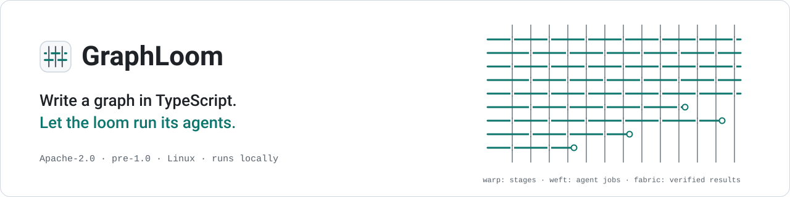

<picture>
  <source media="(prefers-color-scheme: dark)" srcset="docs/assets/banner-dark.svg">
  <source media="(prefers-color-scheme: light)" srcset="docs/assets/banner-light.svg">
  
</picture>

# GraphLoom

You already let AI review your contributors' pull requests and draft fixes for your issues, and you still re-check every line it gives you.

I maintain an open-source project with a steady stream of contributor pull requests and issues. I started using AI for both: a bot to review incoming pull requests, a coding agent to fix issues. The time I hoped to save went into checking its work. A review comment could be right or could be noise, and I could not tell without reading the code myself. An agent would say an issue was fixed, and I had to find out on my own whether a test had ever failed before its change, or whether it had quietly changed things it was not asked to touch. I was doing the review twice. What I was missing was AI output that comes with proof I can check in a minute, instead of claims I have to redo.

## What GraphLoom does

GraphLoom runs coding agents (Claude Code, Codex or Pi, with your own logins, on your machine) through a fixed process, and it only hands you a result once the evidence for it has been checked.

**Pull request review you can act on.** `pr-review` reads an incoming pull request and first asks whether the change is needed at all: is the problem real on the base branch, and does the fix fit your project's design principles? Then three reviewers look at correctness, maintainability and security. Every finding is checked by a second, independent reviewer on a different agent before it is drafted; a finding it refutes is dismissed, not posted as a finding. You get one review comment whose first line is the verdict, with each finding pointing at the lines it is about.

**Issue fixes you can merge on evidence.** `issue-fix` takes an issue and plans the fix. It writes a regression test and proves the test fails on the current code, makes the fix, proves the same test now passes, and has an independent reviewer check the change. You get a local branch with a pull-request description, not a claim that it is done. If the issue leaves a product decision open, the run stops and asks you instead of guessing.

**Runs you can leave alone.** Each run works in its own Git worktree with fixed budgets for agent calls, jobs and time. When something fails, a recovery agent investigates and retries within those limits. `graphloom watch` tells you about progress, a status every 15 minutes, and anything that needs you.

What it does not do: it does not push branches or post reviews unless you enable it, it does not approve or merge pull requests, and it does not run as a hosted service.

## Demo

[PLACEHOLDER: a short recording of one pr-review run ending in the posted review, and one issue-fix run ending in RED → GREEN and the branch]

## Get started

1. **Install.** Releases are local builds for now and bundle their own Node; you need Linux and a logged-in Claude Code, Codex or Pi.
   ```sh
   git clone https://github.com/hanahmily/graphloom && cd graphloom
   scripts/release.sh build 0.0.0 --unsigned
   scripts/install.sh --from release-out/0.0.0/graphloom-0.0.0-linux-x64.tar.gz
   graphloom doctor
   ```
2. **Start a review or a fix.** In a working directory of your own, link the graph and create the task:
   ```sh
   mkdir -p plugins && ln -s "$(graphloom version --root)/examples/plugins/pr-review" plugins/pr-review
   graphloom task new pr-review <owner/repo#N> --repo <your clone> --profile <profile.json>
   graphloom run reviews/<repo>-<N>/task.yaml
   ```
   `<profile.json>` is a path, or a name looked up in `profiles/` beside you and then in the bundle; only `banyandb` ships for `pr-review`, so for another project copy it and adjust it.
   For an issue, write a `task.yaml` with `graph: issue-fix` and `request: "Fix <owner/repo#N>."` (see [`examples/issue-fix-graphloom-task.yaml`](examples/issue-fix-graphloom-task.yaml)) and a `config:` profile copied from `plugins/issue-fix/profiles/`.
3. **See the result.** `graphloom watch <run>` follows it. The review is in the run's worktree under `.graphloom/review/` (`review.html`, and the draft in `draft.md`; `graphloom inspect <run>` prints the path); the fix is a local branch `fix/<issue>`.

Or drive all of this from Claude Code, Codex or opencode with the GraphLoom skills: `graphloom skills install`, then ask it to run issue-fix or pr-review.

## FAQ

**Does it post to my pull requests by itself?** Only if you give it a token for writing (`github.writeTokenEnv` in the runner config). Without one, the run stops with the draft ready for you to read.

**Will it approve pull requests?** No. It posts a comment review; approving stays yours.


## More

How it works inside: [docs/overview.md](docs/overview.md).

## Community

- [Contributing](CONTRIBUTING.md)
- [Security policy](SECURITY.md)
- [Code of conduct](CODE_OF_CONDUCT.md)

## License

GraphLoom is licensed under the [Apache License 2.0](LICENSE); see [NOTICE](NOTICE).
