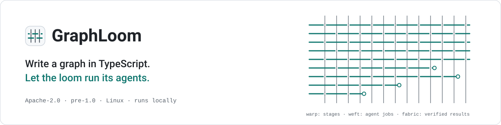

<picture>
  <source media="(prefers-color-scheme: dark)" srcset="docs/assets/banner-dark.svg">
  <source media="(prefers-color-scheme: light)" srcset="docs/assets/banner-light.svg">
  
</picture>

# GraphLoom

You already let AI review your contributors' pull requests and draft fixes for your issues, and you still re-check every line it gives you.

I maintain Apache SkyWalking BanyanDB, the database behind Apache SkyWalking, and it gets a steady stream of contributor pull requests and issues. I started using AI for both: a bot to review incoming pull requests, a coding agent to fix issues. The time I hoped to save went into checking its work. A review comment could be right or could be noise, and I could not tell without reading the code myself. An agent would say an issue was fixed, and I had to find out on my own whether a test had ever failed before its change, or whether it had quietly changed things it was not asked to touch. I was doing the review twice. What I was missing was AI output that comes with proof I can check in a minute, instead of claims I have to redo.

## What GraphLoom does

GraphLoom runs coding agents (Claude Code, Codex or Pi, with your own logins, on your machine) through a fixed process, and it only hands you a result once the evidence for it has been checked.

**Pull request review you can act on.** Two graphs review an incoming pull request, each in its own run. `pr-design-review` asks whether the change is needed at all: is the problem real on the base branch, does the fix fit your project's design principles, and does the codebase already have it? `pr-review` has three reviewers look at correctness, maintainability and security, using the design review's report when there is one. Every finding is checked by a second, independent reviewer on a different agent before it is drafted; a finding it refutes is dismissed, not posted as a finding. You get one review comment whose first line is the verdict, with each finding pointing at the lines it is about.

**Issue fixes you can merge on evidence.** `issue-fix` takes an issue and plans the fix. It writes a regression test and proves the test fails on the current code, makes the fix, proves the same test now passes, and has an independent reviewer check the change. You get a local branch with a pull-request description, not a claim that it is done. If the issue leaves a product decision open, the run stops and asks you instead of guessing.

**Runs you can leave alone.** Each run works in its own Git worktree with fixed budgets for agent calls, jobs and time. When something fails, a recovery agent investigates and retries within those limits. `graphloom watch` tells you about progress, a status every 15 minutes, and anything that needs you.

What it does not do: it does not push branches or post reviews unless you enable it, it does not approve or merge pull requests, and it does not run as a hosted service.

## Demo

Both recordings are real runs, shortened: the commands and their output are quoted from the run's state and the pull requests it produced (long lines are cut with "…"; the times on the right are real).

**pr-review** on [apache/skywalking-banyandb#1460](https://github.com/apache/skywalking-banyandb/pull/1460), recorded with pr-review 0.2x, when one run did both the design review and the detail review: one run, the stop because posting was not yet enabled, the resume, and [the review it posted](https://github.com/apache/skywalking-banyandb/pull/1460#pullrequestreview-5768856844) ("Changes requested: 2 open", two inline comments).



**issue-fix** on [apache/skywalking#14169](https://github.com/apache/skywalking/issues/14169) (BanyanDB): a 9 minute 52 second run, the regression test failing on the base (RED), passing with the fix (GREEN), an independent review, and the branch that became [pull request #1459](https://github.com/apache/skywalking-banyandb/pull/1459).



With reduced-motion enabled the recordings show their final frame.

## Get started

1. **Install.** Releases bundle their own Node. You need Linux, an authenticated `gh`, and a logged-in Claude Code, Codex or Pi. The installer checks the release's signature against the signers file from the release tag.
   ```sh
   gh release download v0.2.0 -R hanahmily/graphloom -p install.sh
   curl -fsSLO https://raw.githubusercontent.com/hanahmily/graphloom/v0.2.0/release/allowed_signers
   sh install.sh --require-signature --allowed-signers allowed_signers
   graphloom doctor
   ```
   The `graphloom` command is installed in `~/.local/bin`; put that directory on your `PATH`. Later versions arrive through `graphloom upgrade` and a daily automatic check.
2. **Start a review or a fix.** In a working directory of your own, link the graph and create the task:
   ```sh
   mkdir -p plugins
   ln -s "$(graphloom version --root)/examples/plugins/pr-design-review" plugins/pr-design-review
   ln -s "$(graphloom version --root)/examples/plugins/pr-review" plugins/pr-review
   graphloom task new pr-design-review <owner/repo#N> --repo <your clone> --profile <profile.json>
   graphloom run reviews/<repo>-<N>-design/task.yaml
   graphloom task new pr-review <owner/repo#N> --repo <your clone> --profile <profile.json>
   graphloom run reviews/<repo>-<N>/task.yaml
   ```
   The design review (`pr-design-review`) posts its open items, or nothing when it is clean, and then names the `pr-review` command; the PR review (`pr-review`) also runs alone. `<profile.json>` is a path, or a name looked up in `profiles/` beside you and then in the bundle; only `banyandb` ships for each graph, and one profile file may serve both, so for another project copy it and adjust it.
   For an issue, write a `task.yaml` with `graph: issue-fix` and `request: "Fix <owner/repo#N>."` (see [`examples/issue-fix-graphloom-task.yaml`](examples/issue-fix-graphloom-task.yaml)) and a `config:` profile copied from `plugins/issue-fix/profiles/`.
3. **See the result.** `graphloom watch <run>` follows it. The review is in the run's worktree under `.graphloom/review/` (`review.html`, and the draft in `draft.md`; `graphloom inspect <run>` prints the path); the fix is a local branch `fix/<issue>`.

Or drive all of this from Claude Code, Codex or opencode with the GraphLoom skills: `graphloom skills install`, then ask it to run issue-fix, pr-design-review or pr-review.

## Run several graphs through a local hub

The hub queues tasks and controls how many graph runs execute at once. A resumed
run uses the same limit. It serves trusted users through one Linux account and an
owner-only Unix socket. Existing standalone `graphloom run` commands remain
outside that limit.

Create `~/.config/graphloom/hub.json` with your desired capacity:

```json
{ "maxConcurrentRuns": 3 }
```

The hub requires a delegated Linux cgroup v2 subtree. `graphloom hub service`
prints a user service unit with `Delegate=yes`; review and install it yourself:

```sh
mkdir -p ~/.config/systemd/user
graphloom hub service --config "$HOME/.config/graphloom/hub.json" > ~/.config/systemd/user/graphloom-hub.service
# A user service reads no shell profile: give it your login shell's PATH, toolchains and
# agent login locations, and (opt-in) the runner config's GitHub token in a 0600 file.
graphloom hub service --capture-env --token-env-file ~/.config/graphloom/hub-tokens.env --write
systemctl --user daemon-reload
systemctl --user enable --now graphloom-hub.service
graphloom hub status     # includes the hub's environment: PATH head, agent CLIs, token variables set
graphloom hub doctor --task ./tasks/fix/task.yaml   # doctor's checks in the hub's environment
graphloom hub submit ./tasks/fix/task.yaml --key fix-14169
graphloom hub list
graphloom hub limit 2
graphloom hub watch <submission>
graphloom hub pause <submission>
graphloom hub resume <submission>
```

Use the runner/supervisor configuration created by `graphloom setup`, or set their
paths in the hub config. The queue pins task/config bytes, repository base, bundle
and runtime identities. Input drift blocks a queued launch. A run retains its
slot until its controller, descendants and external execution have drained.
Automatic continuation is bounded and excludes approvals, exhausted budgets,
unknown stops and unresolved effects. `hub policy` changes a submission's retry
policy; `hub cancel` withdraws it permanently. `hub logs --follow` reads bounded
process logs.

Request panels separately in terminals or coding-agent chats:

```sh
graphloom hub inspect <submission> --panel topology --format ansi
graphloom hub inspect <submission> --panel usage --format text
graphloom hub inspect <submission> --panel overview --format markdown --chat-renderer katex
graphloom hub inspect <submission> --format json
```

The eight panels are `overview`, `topology`, `stages`, `jobs`, `activity`, `job`,
`usage` and `output`; repeat `--panel` to combine them. Colored chat output is
static Markdown/KaTeX for an assistant reply, with plain details and fallbacks.
`auto` stays plain until a host profile is qualified; tool output alone does not
make a host render math. An agent can include the requested panel in its reply;
`hub watch` follows updates in the terminal.
No HAPI changes, screenshot capture or MCP connection are required.

Source-level tests cover the scheduler, controller integration, Unix transport,
and renderers. Deployment still needs qualification on the operator's
systemd/cgroup/container setup; deployed HAPI color rendering is also a separate
host check. Live harness output and aggregate token/context counters are shown as
unavailable when the owning runtime cannot report them. See the
[hub design](docs/design-run-hub.md) and [panel design](docs/design-monitor-panels.md).

## FAQ

**Does it post to my pull requests by itself?** Only if you give it a token for writing (`github.writeTokenEnv` in the runner config). Without one, the run stops with the draft ready for you to read.

**Will it approve pull requests?** No. It posts a comment review; approving stays yours.


## More

How it works inside: [docs/overview.md](docs/overview.md).

## Community

- [Contributing](CONTRIBUTING.md)
- [Security policy](SECURITY.md)
- [Code of conduct](CODE_OF_CONDUCT.md)

## License

GraphLoom is licensed under the [Apache License 2.0](LICENSE); see [NOTICE](NOTICE).
