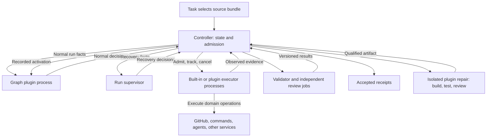

# GraphLoom architecture

Status: revised 2026-09-27; standalone implementation partial, agent-host mode proposed. The
[core design](design-typescript-core.md) is authoritative.

The graph owns normal routing; the supervisor owns exceptional recovery and works
to finish the run—exhausting authorized remedies before Stop; the controller admits
both and derives acceptance from required current evidence. Neither an agent
success claim nor a plugin route can substitute for validation.

Plugins own execution logic and can reuse GraphLoom-provided executors. Built-in
and custom executors use the same lifecycle interface and run outside the
controller. New integrations ship as compatible executor packages or plugin code;
they do not require controller releases. The controller retains durable operation
records, cancellation, scopes, and budgets. See the [executor design](design-executors.md).

The diagram above is standalone mode. In proposed
[agent-host mode](design-agent-host.md), an existing Claude Code or Pi session
calls a host-facing controller service, receives admitted assignments, and supplies
recovery proposals. It replaces the CLI-driven agent loop and the separate Pi
supervisor, while the graph still selects normal work and the controller retains
acceptance. Independent review uses another session. Both drivers call the same
durable transition interface; only one driver owns a run.

Required outcomes are pinned independently from versioned validator bindings.
A qualified source patch or authorized validator replacement changes implementation
while retaining those outcomes. Activation starts a fresh process, records old/new
identities, and invalidates affected evidence. Resume uses the committed active
version and preserved budgets.

The first complete release is Write → Review on an isolated local worktree,
including same-run recovery from a defective readable validator. Opaque code,
ambiguous requirements, missing authority, and exhausted limits can still stop a
run. See the core design for exact contracts and release scenarios.
