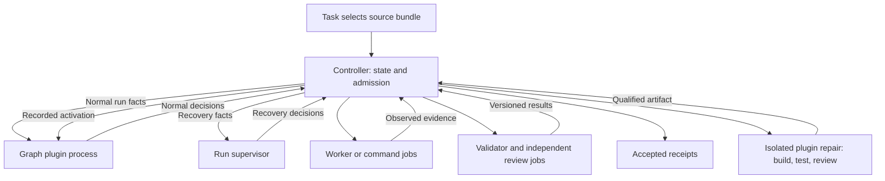

# GraphLoom architecture

Status: TypeScript target, 2026-09-22; implementation pending. The
[core design](design-typescript-core.md) is authoritative.

The graph owns normal routing; the supervisor owns exceptional recovery; the
controller admits both and derives acceptance from required current evidence.
Neither an agent success claim nor a plugin route can substitute for validation.

Required outcomes are pinned independently from versioned validator bindings.
A qualified source patch or authorized validator replacement changes implementation
while retaining those outcomes. Activation starts a fresh process, records old/new
identities, and invalidates affected evidence. Resume uses the committed active
version and preserved budgets.

The first complete release is Write → Review on an isolated local worktree,
including same-run recovery from a defective readable validator. Opaque code,
ambiguous requirements, missing authority, and exhausted limits can still stop a
run. See the core design for exact contracts and release scenarios.
