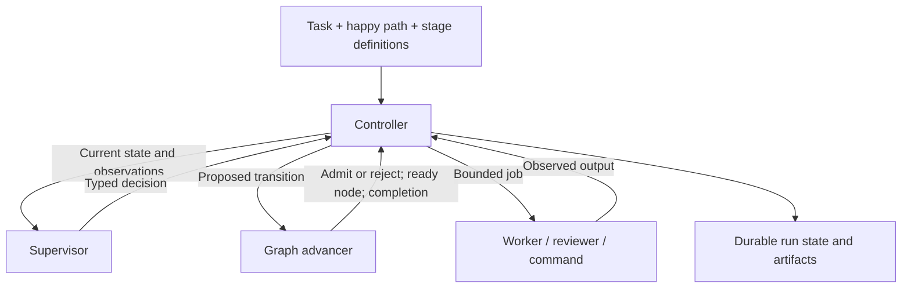

# GraphLoom minimal core

Status: proposed for review, 2026-09-22. No runtime is implemented yet.

This document defines the first runnable GraphLoom release. It takes precedence
over the broader initial architecture and research proposals for implementation
scope. “Graph advancement” means determining which node may run and which required
stage may complete.

## 1. Goal and scope

An operator supplies a task, a target repository, and a happy path. GraphLoom uses
multiple agents to produce the required result, validates their output, and lets
one supervisor decide how to recover when execution deviates from that path.

The core has exactly three components:

1. **Graph advancer:** pure rules for readiness, accepted progress, and completion.
2. **Supervisor:** the LLM session that plans work and makes semantic decisions.
3. **Controller:** the process that owns state, runs agents and checks, and applies
   admitted decisions.

The first release runs on one host, through a CLI, with one active job per run.
Multiple agents means separate worker and reviewer sessions with distinct tasks;
it does not initially mean concurrent workers. One agent backend is sufficient.
The same backend may supply the supervisor, implementation agent, and independent
reviewer, using separate sessions and scopes.

The first release includes local execution, verification, bounded correction,
inspection, stop, and resume. A web portal, distributed scheduling, remote context
services, automatic publication, and arbitrary milestone DAG authoring are outside
this release.

## 2. Task inputs and an isolated checkout

### 2.1 One task file

The operator supplies `task.yaml`. It owns the graph selection, target repository,
and request; they are not separate required CLI flags:

```yaml
graph: hello
repo: ./test-repo
request: |
  Create GREETING.txt containing exactly "Hello, GraphLoom!" followed by
  one newline. Do not modify other files.
```

The graph declaration in `graphs/hello.yaml` contains only the required happy path:

```yaml
happy_path: [write, review]
```

A matching `graphs/hello.md` explains each stage's purpose, outcomes, and evidence
expectations. Stage names alone cannot define success. Definitions describe what
must be established; the supervisor chooses concrete checks and supporting jobs.
No hooks, failure routes, or reentry declarations are required in the graph file.

Proposed CLI, not an existing executable:

```sh
graphloom run task.yaml
graphloom inspect <run-id>
graphloom stop <run-id>
graphloom resume <run-id>
```

Paths resolve relative to the task file, not the shell's current directory:

- `graph: hello` resolves to `graphs/hello.yaml` and `graphs/hello.md` beside the
  task file. Graph IDs must be simple names, not arbitrary paths.
- A relative `repo` resolves from that same directory; an absolute local path is
  also accepted. The controller resolves the actual Git worktree root.
- `request` is required nonempty text. Unknown task keys, missing definitions,
  invalid graphs, and repositories without a commit prevent execution.

The MVP accepts local Git repositories with a working checkout. It does not clone
URLs or fetch remote changes. Project-level settings select the installed agent
backend and finite limits. Intake snapshots the task, graph, stage definitions,
and resolved settings. Editing `task.yaml` later does not change a running or
resumed run. Changing the requested goal requires a new run.

The supervisor derives an acceptance plan from these pinned sources. A separate,
read-only reviewer checks that plan before the writer starts. Omitted requirements
or contradictions are returned to the supervisor. Routine accepted plans proceed
automatically; an unresolved source conflict stops the run with a precise reason.
Plan review is a supporting node, not a third required stage.

### 2.2 One controller-created Git worktree per run

The controller never executes jobs in the supplied checkout. It:

1. Resolves the source checkout and pins its current `HEAD` commit as `base_commit`.
2. Records creation intent, a unique run ID, branch `graphloom/<run-id>`, and a
   destination under the configured local run directory.
3. Creates an isolated worktree at that exact commit, equivalent to:

   ```sh
   git -C <source-repo> worktree add -b graphloom/<run-id> <run-root>/work <base-commit>
   ```

4. Records the actual worktree identity before allowing an agent to run.
5. Runs the writer, command checks, and read-only reviewer in that run worktree.

The source checkout's tracked modifications, staged changes, and untracked files
are not copied. The run begins from the pinned commit even when the source
checkout is dirty. The source working files, index, and current branch stay
unchanged. Git necessarily registers the new worktree and branch in the shared
repository metadata; the controller serializes those operations per repository.
Agents cannot write that shared metadata or operate on the source checkout.

The branch initially points to `base_commit`; the MVP preserves the result as
worktree changes without automatic commits, merges, or pushes. It retains the
worktree on success, stop, or failure. `inspect` reports the source repository,
base commit, run branch, worktree path, and current workspace fingerprint so the
operator can inspect the exact result.

Resume reuses the recorded worktree. It verifies ownership, identity, and current
content before dispatch. Unexpected content changes invalidate affected evidence
and require supervisor assessment. A missing or mismatched worktree stops resume;
it is never silently recreated or reset. No automatic cleanup is included.

Persist worktree creation intent before Git mutations. On an interrupted creation,
reconcile the branch and worktree registration against that intent. Adopt only an
exact matching run worktree; an unrelated path or branch collision is a blocker.
Never discard a pre-existing checkout to make creation succeed.

## 3. Component boundary



| Concern | Graph advancer | Supervisor | Controller |
|---|---|---|---|
| Required stage order | Enforces | Reads | Persists |
| Agent selection and prompts | Checks references and scope | Chooses | Launches |
| Checks and evidence strategy | Checks coverage and receipt references | Proposes | Executes and records |
| Interpretation of a failure | No domain classification | Decides | Supplies original observations |
| Supporting work and reentry | Validates graph changes | Proposes | Applies atomically |
| Accepted stage progress | Checks prerequisites and evidence validity | Requests acceptance | Issues receipt |
| Limits, process ownership, cancellation | Reads admission facts | Cannot override | Enforces |
| Run completion | Computes from current receipts | Explains result | Finalizes |

There is no separate classifier, recovery daemon, or domain-specific routing
table. The controller's process runner and state store are implementation helpers,
not additional decision-making components.

## 4. Graph model

### 4.1 Required stages

The happy-path list produces an immutable ordered stage graph:

```text
write → review
```

Each stage has an ID, source-bound obligations, and a current accepted receipt or
no receipt. Stage definitions can describe different domains; no shared rule
requires an assignment document, source code, or a PR.

The controller can advance the stage cursor only when the current stage and all
predecessors have valid receipts. Successful completion requires every declared
stage. A blocked task or a justified no-op does not fabricate stage completion.
The MVP records it as a stopped run with a reason.

### 4.2 Execution nodes

The supervisor expands the required stages into concrete attempts and checks.
The execution graph is append-only: completed nodes are never reset or rewritten.

| Field | Meaning |
|---|---|
| `id` | Stable operation ID, reused when reconciling an interrupted operation |
| `stage` | Required stage this job supports; omitted only for initial plan review |
| `kind` | `agent` or `command` |
| `purpose` | `work`, `check`, or `review`; descriptive, not routing authority |
| `after` | Earlier nodes whose observations must exist |
| `requires` | Accepted stage receipt IDs required before dispatch |
| `spec` | Agent role and prompt, or command argv; input artifact references |
| `scope` | Read/write roots and allowed effects |
| `bounds` | Timeout and available call reservation |
| `repair_attempt` | Controller-owned association with a correction, if applicable |

Dependencies reference existing nodes only. This makes appended dependency edges
acyclic by construction. Each dependency means “its observation is available,”
not “it succeeded.” Thus a diagnostic job can depend on a failed command without
being permanently blocked. Required successful outcomes use the separate
`requires` receipt references.

Retries and corrections create new node IDs with a `supersedes` or `repairs`
lineage reference. Those references are explanatory links, not readiness edges.
An interrupted operation keeps its ID during reconciliation; an intentional
second execution is a new attempt and spends the appropriate allowance.

### 4.3 States and readiness

```text
pending → running → observed
                 → interrupted
pending/running → cancelled
```

`observed` means the controller captured a result, including nonzero exits,
timeouts, malformed agent responses, and reported blockers. It does not mean the
job was successful or its stage was accepted. `interrupted` means the operation's
outcome could not be established after process loss.

A node is ready only if:

- The run is active and the node is pending.
- Every `after` dependency has an observed result.
- Every required receipt is valid for the node's input revisions.
- Its stage is the earliest unaccepted stage, or it is authorized supporting work
  for that stage; initial plan review is the bootstrap exception.
- Scope and budget admission succeeded, and no other job is active.

Independent read-only checks are still serialized in the MVP. The supervisor
appends work in intended order; the advancer selects the earliest ready node.
It never invents a repair when no node is ready. The controller sends the blocked
state back to the supervisor, subject to the same finite decision budget.

### 4.4 Reentry

`reenter(write)` invalidates write's receipt and every later stage receipt in
one transition. Pending nodes that rely on those receipts are cancelled. A
reentry decision is admitted only between jobs. New attempts are appended:

```text
write#1 → check#1 → diagnose#1 → write#2 → check#2 → review#1
```

Historical receipts and outputs remain inspectable. They are no longer usable
as current completion evidence. The graph advancer enforces this rule regardless
of the supervisor's explanation.

## 5. Supervisor

### 5.1 One logical session per run

The supervisor sees the pinned task and stage definitions, current stage,
execution graph summary, observations, evidence references, and remaining limits.
It can request bounded inspection jobs when more information is needed.

Its decisions cover the entire run: initial planning, agent selection, validation,
diagnosis, correction, reentry, and the final delivery explanation. Workers and
reviewers are child sessions. No new supervisor is created for each failure.

Store session identity and concise decision summaries in run state. If native
session resume is unavailable, reconstruct the logical session from those durable
facts and pinned artifacts. Changing the backend session never resets limits.

### 5.2 Minimal decision protocol

Every decision includes `run_id`, `generation`, `expected_revision`, a unique
`decision_id`, an `action`, and a concise `reason` with evidence references.

| Action | Meaning |
|---|---|
| `plan` | Propose or revise the derived acceptance plan; independent review required |
| `append` | Add bounded agent or command nodes with their dependencies |
| `accept` | Request acceptance of the current stage, citing evidence |
| `reenter` | Return to a named required stage and invalidate dependent evidence |
| `stop` | Leave the run resumable with the blocker and next required input |

The protocol has no unrestricted state patch, “mark successful,” or arbitrary
code execution in the controller process. Commands are execution nodes, use argv
without implicit shell expansion, and remain subject to scope and time limits.

Checks, setup operations, and helper agents all use `append`. A repair supplies a
replacement node or acceptance-plan revision, not an edit to historical evidence.
The next normal stage follows from accepted receipts; the supervisor plans its
jobs but does not choose an alternative happy-path order.

Malformed or rejected decisions return structured reasons and current facts to
the same supervisor session. They consume decision-call allowance. No hard-coded
domain error family is required before the supervisor may investigate a failure.

### 5.3 Agent handoff: typed results and artifact references

Agents do not communicate through a shared chat. They have two controller-mediated
channels:

| Channel | Content | Owner |
|---|---|---|
| Data | Immutable artifact references and the run worktree at a recorded revision | Controller snapshots and supplies inputs |
| Control | Typed job result, review verdict, blocker, and concise explanation | Agent reports; controller records; supervisor interprets |

Before launch, the controller supplies a versioned task packet. For example:

```json
{
  "version": 1,
  "run_id": "hello-001",
  "node_id": "review-1",
  "generation": 1,
  "stage": "review",
  "role": "reviewer",
  "workspace_revision": "ws:17",
  "inputs": ["artifact:task", "artifact:write-result-1", "artifact:check-1"],
  "instruction": "Review the exact requested greeting and the complete change scope."
}
```

`ws:17` is an illustrative controller-issued identifier for a content fingerprint,
not just a Git commit. It covers the pinned base and current tracked, untracked,
and ignored workspace contents outside Git metadata. The packet also resolves the worktree, read-only input mounts,
private output directory, and admitted bounds through the runner interface.
Agents cannot supply substitute paths that expand these scopes.

Every agent invocation returns a single structured result through a dedicated
`result.json` file in its private output directory. Logs and streaming activity use
separate stdout/stderr channels; they are not parsed as the final result. A first
backend must support this result-file contract directly or through its adapter.

```json
{
  "version": 1,
  "run_id": "hello-001",
  "node_id": "review-1",
  "generation": 1,
  "input_revision": "ws:17",
  "status": "completed",
  "verdict": "approve",
  "summary": "The greeting bytes and changed-file scope match the task.",
  "outputs": [{"name": "review-report", "path": "review.md"}],
  "evidence_refs": ["artifact:check-1"]
}
```

`status` is `completed`, `blocked`, or `failed`. Review jobs additionally require
`verdict: approve` or `request_changes` when completed. A completed review may
request changes; that is an unmet acceptance condition, not a successful stage.
A writer omits `verdict`. A blocker can include `conflict`, containing its concise
explanation and source references; it cannot command a route itself.

The controller validates the result schema and invocation identity, resolves each
output path within that job's output directory, and rejects escaping paths,
symlinks, and missing or oversized outputs. After the child has stopped, it copies
outputs into immutable artifact storage, hashes them, and issues artifact IDs.
It records command exits and workspace changes from execution directly. Artifact
references in agent output must refer to inputs actually supplied to that job.
The controller derives a change manifest for code/file outputs in the worktree.

A JSON result claiming tests passed is not a controller-issued check receipt.
Missing or malformed result files remain observations of failure even if the
process exits zero. Each accepted observation binds the actual invocation, inputs,
workspace fingerprint, and output digests; agent-supplied identity never overrides
controller state.

The next agent receives only explicit referenced artifacts and the current
admitted workspace revision. Handoffs are therefore reproducible and inspectable:

```text
writer → result + file changes → controller snapshots artifacts
       → supervisor selects checks and review
       → controller supplies checked inputs → reviewer
```

On disagreement, the supervisor receives the review report and chooses a new
write attempt or further inspection. Review does not directly call the writer.
Supporting jobs and revised task packets remain visible as execution graph nodes.

## 6. Controller

The controller is the sole state writer and job launcher. Its main loop is:

```text
load state and acquire exclusive run ownership
reconcile any unfinished operation
while run is active:
    if the graph has a ready node:
        reserve limits and persist dispatch intent
        launch the bounded job
        capture observation and persist settlement
        if the result reports failure or a blocker:
            require a supervisor decision before further dispatch
    elif every stage has a valid accepted receipt:
        persist succeeded and return
    else:
        reserve a supervisor call
        obtain a typed decision
        validate it against current generation, revision, and policy
        apply the admitted transition, or record its rejection
```

Commands, workers, reviewers, and the supervisor use a narrow runner interface.
The first implementation supports one backend and a scripted fake for tests.
It must provide bounded launch, output capture, cancellation, process identity,
and enforceable writable roots. Agent output is data parsed by the controller;
it cannot invoke state mutation directly.

The supervisor and reviewers have read-only task/context access. Writer jobs can
write only the run worktree and their own output directory.
Reviewers can write reports only in their own output directory. Command checks
receive a read-only worktree and separate scratch/output directories. Control
state is outside those write roots. The adapter must enforce these boundaries
using its host sandbox; directory separation alone is insufficient. A backend
without the required isolation cannot be enabled. This adapter boundary must be
proven before using real agents. The MVP grants no external-write capability;
the selected runner must enforce that scope as well as filesystem write roots.

### 6.1 Evidence and acceptance without configured hooks

Validation is explicit graph work. The supervisor adds `command` nodes for
machine-checkable obligations and `agent` review nodes for semantic judgments.
The controller executes these jobs and records their actual outcomes. Removing
hook declarations from graph YAML does not remove independent checks.

The `hello` plan must establish both exact file bytes and complete change scope.
A passing content check alone cannot satisfy the task if another file changed.
Both obligations can be checked by one bounded command node. Its actual argv or
script and digest are persisted in the node specification and reviewed before
use; they are not hidden pre/post-stage callbacks.

The acceptance plan maps each source requirement to a check, an independent
review, or both. Plan review is a fixed controller-required procedure and cannot
be removed by a plan revision. It has a fixed bounded invocation, not a recursive
reviewer tree.

A new or changed check requires independent review of its connection to the
unchanged obligation. Defect-sensitive negative cases are required where the
obligation is machine-checkable. This prevents replacing a failed check with an
always-passing command. Unresolved semantic disagreement stops bounded progress.

For each executed check the controller records its argv or tool identity,
workspace fingerprint, source/plan revision, exit status, and artifact digests.
Reviewer output is recorded as independent judgment, not a deterministic proof.
An `accept` decision succeeds only when:

1. The acceptance plan has passed independent review.
2. Required checks actually ran and passed on the relevant inputs.
3. Required independent reviews accepted the exact applicable revision.
4. No referenced evidence is missing or stale, and predecessor receipts are valid.

Use evidence-input fingerprints rather than invalidating everything on every
write. Plan-review evidence binds the task, definitions, and acceptance plan;
write evidence binds the target file and complete workspace change manifest;
review evidence binds that same workspace revision and the executed checks.
File changes invalidate content-dependent evidence. Reports stored outside the
worktree do not change its fingerprint. For the MVP, fingerprint the full workspace
change set, including untracked and ignored file changes outside Git metadata,
instead of guessing fine file-level dependencies. Check scratch files live outside
the worktree so scope checks do not mistake their own outputs for deliverables.

The source requirements are immutable within a run. Derived interpretation and
check recipes may be corrected after review. Changing the actual requested goal
requires a new run in this version.

### 6.2 Durable state and stop/resume

Use a private host directory containing one versioned `state.json`, append-only
output artifacts, pinned sources, the isolated `work/` checkout, and a per-run lock.
Only the controller can write the state and immutable artifact directories. The
state document contains the graph, receipts, operation journal, decisions, and
counters. Commit transitions
by synced temporary write and atomic replacement under a cross-process lock.
Unreferenced artifacts after a crash are harmless; missing referenced artifacts
stop the run. Do not create multiple independent authoritative ledgers.

Persist `dispatching` intent before spawning and process identity afterward. The
runner must give child jobs a bounded lifetime if their controller disappears.
On restart, confirm the old job has stopped before launching anything else.
An ambiguous spawn or partially modified workspace produces an interrupted node;
the supervisor inspects the current workspace before proposing another attempt.
Never infer that a missing result means the operation never ran.

The CLI stops a run through a durable stop request that the active controller
polls while supervising a job. Requests enter a small atomic command inbox without
requiring the active controller's ownership lock; only the controller applies them
to canonical state. Request IDs make repeated stop commands idempotent.
The controller increments generation, stops dispatch,
cancels/reaps its child, and records `stopped`. A forceful controller termination
is handled by the same interrupted-operation reconciliation. Late outputs from an
old generation cannot advance the graph.

Run states are `active`, `stopped`, and `succeeded`; active operations additionally
expose `stopping` while cancellation finishes. Resume obtains the run lock,
reconciles interrupted work, checks remaining limits, and starts another generation
of the same run. It never restores obsolete receipts or replenishes usage.

### 6.3 Minimal finite limits

Project settings carry these proposed defaults; graph YAML does not:

| Limit | Initial default |
|---|---:|
| Supervisor and child agent invocations combined | 64 per run |
| Executed nodes, including commands | 128 per run |
| Corrective attempts | 8 per run |
| Duration of one agent or command invocation | 20 minutes |
| Active run execution time | 4 hours |

These are implementation starting points, not measured performance guarantees.
The controller reserves an invocation/node before launch. Failures, invalid
decisions, and rejected candidate plans consume their applicable allowance.
There are no free automatic invocation retries in the MVP.

A corrective attempt opens when the supervisor starts changing work after a
failed check, rejected review, reported conflict, or invalidated accepted result.
It contains one replacement plan/recipe and its trial. Internal inspection jobs
consume global call/node/time limits. A failed trial ends that attempt; another
correction consumes the next one. Successful correction closes only with accepted
evidence resolving the blocker. Reentry is corrective even if described as
ordinary planning. This uses observed execution state, not a domain error taxonomy.

Active time includes supervisor and job execution and is durably accumulated;
it pauses only when the run is stopped. Every individual invocation also has its
wall-clock deadline. Limits survive process death and resume. Exhaustion stops
the run with usage and the unresolved blocker. No budget-extension API is needed
for the first version.

## 7. Minimal end-to-end example: write and review

The fixture repository has a committed baseline without `GREETING.txt`. A single
writer creates that file. A separate reviewer evaluates the result. The required
path remains `write → review`; plan review and command checks are supporting nodes.

### 7.1 Successful run

1. `graphloom run task.yaml` pins the inputs and source `HEAD`, then creates the
   run worktree and branch.
2. The supervisor proposes an acceptance plan and a bounded content/scope check;
   a separate plan-review job qualifies them.
3. The writer creates `GREETING.txt` and returns a structured result. The controller
   snapshots its report and records the workspace change manifest.
4. The controller executes the proposed check. It establishes exact bytes
   `Hello, GraphLoom!\n` (UTF-8, one newline) and that the only changed path versus
   the pinned baseline is `GREETING.txt`. It includes staged, unstaged, untracked,
   and ignored workspace changes in scope accounting.
5. With a valid check receipt, the supervisor requests acceptance of write. The
   controller accepts it, making review eligible.
6. A separate read-only reviewer receives the task, writer result, check receipt,
   and exact workspace revision. It returns `approve` or `request_changes` with
   evidence. It does not change the file or rerun the writer itself.
7. Approval and fresh prerequisite evidence allow review acceptance. The graph
   advancer finds both receipts valid, and the controller marks the run succeeded.
8. The CLI reports the result, evidence references, and retained worktree path.
   The source checkout is unchanged; there is no automatic commit, push, or merge.

```text
plan review → write#1 → content/scope check#1 → accept Write → review#1 → accept Review → succeeded
```

Write acceptance requires the deterministic check; it does not depend on the
later required Review stage. This avoids a circular dependency. Final success
still requires that independent Review stage.

### 7.2 Corrective run

For the negative fixture, the first writer deliberately omits the newline or
modifies another file. The actual check fails; the supervisor receives its output
and appends diagnosis and another write attempt. The required Write stage remains
unaccepted until a corrected check passes.

If the review stage finds a defect after Write was accepted, the supervisor uses
`reenter(write)`. The controller invalidates the Write receipt and any dependent
review evidence, then admits a new correction under the remaining allowance.

```text
write#1 → check#1 → review#1 requests changes
  → supervisor reenters Write
  → write#2 → check#2 → review#2 → succeeded
```

Both cases preserve the two-stage declaration, use the same supervisor session,
and spend corrective allowance. The supervisor may repair a defective check only
after independent qualification against the unchanged task requirements.

## 8. Implementation shape and acceptance

Proposed stack: one Go CLI executable. Use standard-library process and file
operations plus a strict YAML parser. Keep the graph rules free of subprocess,
provider, and storage dependencies. Package layout, seams, and import rules are
in [codebase.md](codebase.md).

```text
cmd/graphloom/                 CLI: run, inspect, stop, resume
internal/graph/                pure advancer
internal/supervisor/           view assembly and decision decoding
internal/controller/           harness, loop, seams (Runner, Store, Worktree, Clock)
internal/adapter/              process/scripted runner, fs store, git/fake worktree, clocks
examples/graphs/               happy-path declarations and matching stage definitions
test/scenarios/                scripted agents and subprocess regression fixtures
```

Implementation sequence:

1. **Graph + fake execution:** parse the happy path, define states and receipts,
   implement pure advancement, and complete the scripted two-stage hello graph.
2. **Supervisor + real runner:** wire one backend, plan review, independent checks,
   adaptive reentry, finite limits, and enforceable write scopes.
3. **Runnable CLI:** add `task.yaml` intake, isolated worktree creation, persistence,
   ownership, crash reconciliation, stop/resume, and a real hello demonstration.

The release gate is `graphloom run task.yaml` completing the hello task through
Write and Review in an isolated worktree, plus a failing-first-attempt fixture
that recovers without editing the graph declaration.
Regression tests must also establish:

- A failed node can feed a diagnostic node; acceptance still requires passing evidence.
- A worker cannot write controller state or mint its own accepted receipt.
- Skipped stages, stale evidence, reordered progress, and weakened checks are rejected.
- Reentry appends attempts and invalidates downstream evidence without deleting history.
- Duplicate decisions and stale generations cannot apply a transition twice.
- Crashes before/after spawn and settlement do not duplicate work or reset limits.
- Stop reaps work; resume reconciles before dispatch; exhausted runs stay stopped.
- Unknown failures can reach the supervisor without a new domain classifier.
- Result schema failures, unknown artifact references, escaping output paths, and
  stale packet revisions cannot become accepted evidence.
- Content and scope checks detect a missing newline and an unrelated file edit.
- A dirty source checkout stays unchanged; its uncommitted changes are absent from
  the run worktree, which starts at the pinned commit.
- Starting from another shell directory resolves the same task-relative paths.
- Worktree creation crashes reconcile safely; unrelated branch/path collisions stop.
- Resume uses the original worktree and base even after the source branch advances;
  missing worktrees stop instead of silently losing work.
- No backend can mutate shared Git metadata or bypass its admitted write roots.

Review focus: the three component boundaries, append-only attempt graph, serial
execution scope, source-bound acceptance, and finite correction model. Later
features should build on this runnable core rather than become prerequisites.
