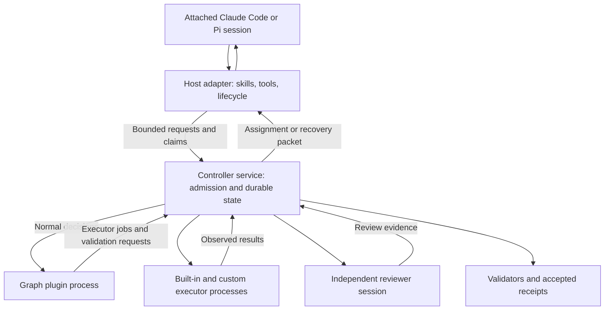

# Agent-host mode

Status: proposed design, 2026-09-27; not implemented. This extends the
[core design](design-typescript-core.md), alongside standalone mode. The existing
headless Claude Code worker and its job-tool MCP bridge are reusable groundwork,
not an implementation of this mode.

## Decision and scope

Let an existing coding-agent session drive a GraphLoom run. The host supplies the
model, conversation, native coding tools, and continuation mechanism. GraphLoom
supplies the graph, durable state, executor integration, validation, recovery
admission, and finite run limits. No separate supervisor (Pi, Claude Code, or
Codex harness) is started for an agent-host run. One attached primary session
performs assigned implementation work and also fulfills the supervisor role
during recovery.

Independent review still requires another session when the graph declares it.
A graph with only deterministic checks can use one agent session throughout.
One primary session with separate reviewers is not the same as one model context
for every role. The step list, order, and required outcomes remain fixed.

The first adapter targets local Claude Code. The controller interface is neutral
to the host; a Pi extension can implement the same contract later. No RSI,
cross-run memory, distributed scheduler, or automatic publication is introduced.

| Responsibility | Standalone mode | Agent-host mode |
|---|---|---|
| Start and continue work | GraphLoom CLI/controller loop | Attached host session through tools |
| Normal routing | Graph plugin | Same graph plugin |
| Implementation work | Controller-launched coding executor | Attached host receives a bounded assignment |
| Exceptional recovery and repair coding | Run-wide supervisor session on the pinned harness (Pi, Claude Code, or Codex) | Same attached primary session in supervisor role |
| GitHub/command executors | Controller-managed execution lifecycle | Same lifecycle, requested through host tools |
| Acceptance and durable truth | Controller | Same controller |
| Independent review | Separate reviewer session | Separate reviewer session |
| Model selection and credentials | Configured worker/Pi adapters | Host owns its model and login |

The supervisor is a role and protocol, not a mandatory Pi process. Pi remains the
standalone supervisor implementation. A host adapter does not create a second
state machine or replace the graph with prompts.

## Operator experience

Keep `task.yaml` unchanged. Execution mode is an invocation choice, pinned for the
run. Proposed commands below are design sketches, not available CLI commands:

```text
# Standalone, existing behavior:
graphloom run task.yaml

# From a Claude Code session with the proposed plugin loaded:
/graphloom:start /absolute/path/task.yaml
/graphloom:status
/graphloom:resume <run-id>
/graphloom:stop <run-id>
```

Start creates the normal isolated worktree and binds the session to it. The adapter
returns absolute worktree and artifact paths and establishes tool working-directory
handling before admitting coding. Never assume an interactive session changed cwd
because a previous shell command ran `cd`. Reject writes against the original
checkout; preserve source files, index, branch, and shared Git metadata.

Each session drives one run at a time in the initial release. A session already
attached elsewhere must detach with no unsettled work before switching. Installing
or loading the plugin neither starts a run nor grants publication permission.
Status and inspection need no writer lease. Stop remains available through the
ordinary CLI even if the host is unresponsive.

A host may keep working immediately while admitted work exists. A native scheduled
prompt is only a way to wake an idle session. Every wake rechecks controller state;
it cannot reset a budget, revive a stopped run, or claim success from conversation.
The plugin provides explicit run-specific continuation instructions and does not
overwrite an existing `.claude/loop.md`. It cancels only schedules it owns when the
run stops or finishes. If scheduling is unavailable, manual continuation works.
Closing the host stops agent progress; durable state survives, but the service
does not secretly launch another coding agent to replace it.

## Runtime modules



The new host-facing MCP service is distinct from the existing job-tool bridge:
that bridge serves tools to a child coding process; this service exposes run
attachment, assignments, settlement, and recovery to an external host session.
Both delegate to the same controller admission and executor modules.

Use one local controller service owner per active run, with the existing run lock
and an owner generation. Thin MCP connections may come and go; they cannot each
start a competing loop. Executor jobs can continue under the owner while a host
waits, but their results need no live MCP request. Service restart reconciles the
journal before accepting another claim. No lock is held across an LLM turn.

## Shared controller and host protocol

Refactor the standalone loop into resumable transitions around durable operation
intents and settlements. Standalone and agent-host drivers call these transitions;
there is no copied controller loop. A normal-mode transition evaluates the plugin
and admits its decision. A recovery transition waits for a supervisor proposal.

Expose the following small host interface (names provisional):

| Tool | Contract |
|---|---|
| `attach` | Create/attach an authorized agent-host run; negotiate capabilities and bind host identity and accounting profile |
| `status` | Read current mode, steps, operation status, evidence, budgets, and exact blocker |
| `next` | Drive a bounded amount of deterministic controller work, then return a work offer, recovery packet, wait, stopped, or succeeded |
| `claim` | Atomically claim a current offer and reserve its job/slice/correction allowances as applicable |
| `execute` | Request an allowed executor operation for the current claim; return an operation ID without blocking on a long job |
| `settle` | Submit completed/failed/conflict plus bounded artifacts/summary for a claim; start controller observation and validation |
| `propose` | Submit an existing supervisor action during recovery; persist its intent and return an operation ID/settlement |
| `release` | Detach an idle host, or request an operator stop; fence claims before acknowledging stop |

Transport-level heartbeat is handled by the adapter, not by repeatedly prompting
the model. `next` is a bounded mutation, not an alias for read-only status. Duplicate
requests return recorded outcomes. Long jobs use IDs and subsequent status reads;
MCP request timeouts do not mean the job failed or authorize restarting it.

Before evaluating the plugin or requesting a new supervisor decision, `next`
checks for outstanding work and existing offers. Returning an existing offer or
`wait` for pending work does not evaluate the plugin, spend the decisions budget,
or increment the no-progress counter. Prefer `status` for polling operation IDs;
repeated `next` polls have the same exemption. Actual admitted/rejected graph or
supervisor decisions still spend their normal allowances and participate in
no-progress detection, even if that call eventually returns `wait`. Waiting for
pending work still counts toward its deadline and active-run time; polling cannot
extend either limit.

Every mutation binds run ID, authenticated host binding, host epoch, expected
state revision, request ID, and when relevant operation/claim ID and attempt.
For retries, authenticate first and look up the durable request ID: the same
payload returns its recorded outcome or an in-progress operation handle, even if
its expected revision is now old. Reuse with different payload is rejected. Apply
revision checks only to new requests; reconcile an existing intent without
redispatching its effect.

A host epoch is the controller's durable, monotonically increasing fencing number
for the run's primary-host binding, distinct from the service owner generation.
Initial attachment creates it. Explicit rebind, host-claim expiry, detach, and
operator stop advance it atomically while fencing the old binding and claims.
Resumption after fencing requires an explicit authorized attachment using the new
epoch; no counters or operation identities reset. Recovery attachment may report
verified drainage of a fenced claim under the current epoch, but cannot admit new
work until the quiescence/reconciliation barriers clear. Old-epoch mutations,
renewals, and quiescence
acknowledgments are rejected, including request-ID replays.

A transport reconnect to a still-valid binding preserves its epoch and outstanding
claim. The adapter authenticates continuity and replaces the old connection's
transport authority; two connections cannot independently renew or mutate the
binding. Reconnect alone grants neither a new claim nor a new deadline. Controller
restart restores the persisted epoch and reconciles expiry before accepting work;
it does not silently rebind the host.

Capabilities are bound by the adapter, never accepted because the model asserts
it is a reviewer or supplies another session ID. Reject stale revisions before
effects. Keep connection secrets outside prompts and artifacts. Transport access
is local and scoped; a task's contents cannot select arbitrary local run stores.

`next` may advance pure plugin decisions, start an executor, or schedule validation
within existing budgets. Its responses are a closed union:

```ts
type Next =
  | { kind: "work"; offer: AssignmentOffer }
  | { kind: "recover"; episode: RecoveryPacket }
  | { kind: "wait"; operationId?: string; reason: string; retryAfterMs?: number }
  | { kind: "stopped"; reason: string; evidence: string[] }
  | { kind: "succeeded"; receipts: string[] };
```

There is no `complete_run` or `accept_stage` tool. `settle` records a claim about
work, not a receipt. The host cannot run the graph's next stage ahead of acceptance.

## Assignments, executors, and evidence

At intake, bind ordinary implementation jobs to an external-host execution adapter
instead of spawning another coding agent. This is an execution transport binding,
not a change to graph steps, prompts, output schemas, or required outcomes. Only
compatible job contracts may use it: independent reviewers and jobs requiring a
specific harness must use qualified separate executors or fail intake with a clear
unsupported-capability reason. Do not silently reinterpret a custom executor.

An assignment offer contains stage/attempt, purpose, original request, input
artifacts, worktree fingerprint, output contract, permitted tools/paths, deadline,
and remaining budgets. Claim records an external execution in the existing job
ledger with its producer identity. The agent uses its own coding tools in the
admitted tree. Supporting GitHub operations and authoritative test commands go
through `execute` and the existing child-operation lifecycle. Built-in and custom
executors remain equally available without controller-specific domain handlers.

Host-native edits, shell commands, and test summaries are not automatically
controller-observed evidence. `settle` first records a durable settlement intent
and revokes native write admission for the claim. Before completing settlement,
the adapter must confirm that all admitted native work, including background
commands and delegated work, has finished or been cancelled and drained. The
confirmation binds the claim and host epoch; a model's completion summary or an
unchanged fingerprint is not a quiescence acknowledgment. Controller-owned child
operations must also settle or reconcile through their existing lifecycle.

Keep the settlement pending until quiescence is established. If the adapter cannot
confirm it, expose `host quiescence required`, preserve the claim's unsettled work,
and require the same operator reconciliation as an expired host. Restart must
recover this pending barrier rather than infer quiescence from a lost connection.
Do not admit another writer, snapshot for validation, or accept the work before
this barrier completes. Keep native write admission revoked through validation
and acceptance; further edits require a fresh admitted claim.

After quiescence, the controller snapshots the actual candidate and records its
full change manifest, including ignored paths where required by the graph.
Required tests are executed through recorded executors;
validators interpret those results. A native exploratory test can inform the
agent but cannot alone prove the test requirement. Late changes invalidate the
fingerprint rather than being silently included in previously accepted evidence.

No two operations may write the same candidate concurrently. Freeze a candidate
snapshot for tests/review after settlement and bind all results to it. Detect a
changed live worktree before acceptance. While work is pending, the host receives
`wait`; it may inspect status but cannot claim another workspace writer.

## One primary session, explicit recovery roles

In normal mode the host executes plugin-selected jobs. Reporting a conflict enters
recovery through the existing controller trigger; it does not let a worker choose
another stage itself. During recovery, the same host receives current requirements,
last settlement, failure evidence, active versions, remaining budgets, and allowed
supervisor actions. It may propose diagnosis, prompt overrides, retries/reentry,
executor alternatives, source repair, validation, or Return. The controller admits
the proposal using the same rules as the standalone supervisor.

A recovery packet carries a claimable proposal offer. `propose` atomically closes
that proposal claim and records the admitted action intent before exposing any
follow-up assignment. Rejected proposals also settle the slice and record the
rejection; the next proposal requires a fresh claim and spends another slice.
Admission of Return sees the proposal slice as settled and still requires all
other work to be quiescent. The proposal can be settled while its separately
recorded executor or qualification operation remains pending. This avoids making
the primary host wait on an assignment blocked by its own proposal claim.

Repair needs a resumable protocol rather than calling `Supervisor.patchCandidate`
and waiting for this same host inside a synchronous RPC:

1. Admit `QualifyRepair`, reserve a correction, and create an isolated candidate
   from the immutable active version. Return a candidate-edit offer.
2. The primary session claims that offer and writes the repair in the candidate
   tree. It remains the run's supervisor; no second Pi agent writes the patch.
3. `settle` seals the candidate digest. Controller-owned preflight/build/tests run
   against that artifact, followed by independent review.
4. The host proposes activation of the qualified artifact. Controller compatibility
   checks preserve steps, order, requirements, authority, and review independence.
5. Invalidate affected evidence, revalidate, and Return to normal graph execution.

Same-session implementation and recovery are intentional. The host cannot review
its own product or repair when independence is required. Use a controller-launched
reviewer with a distinct session, read-only candidate snapshot, and recorded
identity; the MVP does not trust a primary agent saying it asked a subagent. A later
host-native reviewer adapter must provide controller-verifiable identity and
artifact delivery before it can satisfy this contract. One provider/account can
serve both sessions; independence is not a requirement to buy another model.

Keep one logical supervisor identity for the run. If the original host conversation
is lost, an explicit rebind records old/new host sessions under that identity and
reconstructs context from controller facts and summaries. It does not pretend a new
conversation is the old transcript. Starting a new session never resets limits.

## Leases, disconnection, stop, and resume

Host attachment and the controller service owner are distinct leases. A healthy
connection alone cannot own an assignment indefinitely. Initial defaults: host
heartbeat every 30 seconds, claim lease 90 seconds renewed by the adapter, and an
absolute assignment deadline fixed at claim admission. Implementation and
candidate-edit assignments default to one hour, matching the standalone coding
executor; recovery proposal slices default to 20 minutes. A compatible job's
explicit timeout, or an operator-configured positive finite timeout pinned at
intake, overrides the default. A job's explicit timeout takes precedence over the
operator default. Admission caps every deadline by the remaining active-run time.
Renewal, reconnect, and child execution cannot extend that deadline. These timeouts
are independent of the 90-second liveness lease.
The MVP has no partial-success/checkpoint outcome: deadline expiry interrupts the
job and enters recovery, with work and evidence retained. An admitted retry creates
a new operation/attempt, spends the applicable correction and host-slice allowances,
and may explicitly continue the conversation; it does not mark unfinished work
complete. A graph may split useful work into separate bounded jobs inside an
existing stage, but may not reset one running job's clock by renewing its claim.
Use monotonic clocks within a process and conservatively reconcile recorded
expiries after restart.

Only one primary host claim may be active. Duplicate wakes, two Claude tabs, or a
standalone driver attempting to resume an agent-host run cannot gain another writer.
`driverMode` is pinned; automatic takeover or switching between modes is deferred.

On disconnect, retain the claim until expiry or explicit release; autonomous
executor jobs keep their durable identities. An expired host claim is interrupted,
not succeeded, and its generation is fenced. Reconnect gets a recovery packet with
pending effects and the last accepted receipts, not a blind replay of native tools.
Interrupted remote writes follow the executor reconciliation protocol.

Fencing prevents old results from being accepted; it cannot stop an unrestricted
old host from continuing to edit files. Before allowing another writer, require
adapter-confirmed quiescence and a fresh workspace observation. If quiescence
cannot be established, stop with `host quiescence required`; an operator must stop
the old session/process and authorize reconciliation. Never automatically hand the
same mutable tree to a new host merely because a lease expired.

Operator stop fences claims immediately, cancels controller-owned jobs, signals
the host adapter, and disables its future continuation. Record whether native host
work acknowledged cancellation. GraphLoom cannot promise to kill an externally
owned conversation or retract a GitHub write already accepted remotely. An
unacknowledged stop remains visible as unsettled work until reconciled. Terminal
runs reject future work claims even if a stale native schedule wakes again.

Deletion must check the durable host and operation records under the run lock,
even when the run is stopped and its controller service has exited. Refuse deletion
while host quiescence is unconfirmed or execution effects remain unreconciled;
preserve the worktree and reconciliation journal and report the exact blocker.
A stopped status, expired lease, or absent controller owner does not prove that
external work has stopped. After confirmed quiescence and reconciliation, ordinary
deletion rules apply. `delete --force` authorizes discarding workspace changes,
not bypassing these lifecycle checks.

## Authority, accounting, and honest limits

The host uses its own login and model selection. GraphLoom does not copy Claude
subscription tokens into Pi or switch the interactive host's model itself. Record
host-reported model changes as observations; reject work needing unsupported
capabilities. Pi-specific `switch_model` is unavailable for a Claude-host binding.

Three independent capability axes must be visible at attachment and in inspect:

- **Enforcement:** host-policy/cooperative tools versus OS-confined execution.
  Local hooks can reject many inadmissible calls and help enforce cwd/lease rules,
  but do not turn unrestricted shell into a sandbox. Post-execution diffs detect
  some violations; they do not undo external effects or detect all off-tree writes.
- **Quiescence:** a qualified adapter must be able to revoke new native write
  admission and confirm drainage of every admitted native execution, including
  background commands and delegated work. Negotiate this at `attach` and rebind
  before offering or claiming work; reject an unsupported host with
  `host quiescence unsupported`. A version string or model assertion is insufficient:
  qualify the adapter's concrete native-tool lifecycle tracking and cancellation
  mechanism with background-work and disconnect tests. Native execution modes it
  cannot track must be disabled and denied before admission; if it cannot enforce
  that restriction under its declared profile, reject the attachment. This covers
  admitted work, not arbitrary processes outside a cooperative host's control.
  Loss of the capability mid-run fences work and invokes the quiescence blocker;
  manual reconciliation is an exceptional recovery path, not the normal way an
  unsupported attachment settles every job.
- **Accounting:** exact provider interception versus host-reported/incomplete
  usage. Claude-native compaction, hidden model requests, and subagents cannot be
  advertised as covered by a hard global request count without interception.

Agent-host mode uses explicit finite admission limits: retain 8 corrections, 128
executor jobs/observations, 512 decisions, and 4 hours active run time. Work slices
use the finite deadlines defined above: one hour for coding and 20 minutes for
recovery proposals by default, capped by remaining run time. Add **64 host slices**
per run, covering implementation, recovery
proposal turns, and candidate edits. A recovery proposal claims a recovery slice;
its patch-edit phase claims a separate slice, but shares the existing correction
reservation. Claim reserves before work; an interrupted slice remains spent.
Host-native model usage is reported separately and never recorded as zero simply
because unavailable. Controller-launched model requests retain their own 64-call
allowance to the extent supported by their qualified adapter.

This bounds admitted GraphLoom work, not total tokens or requests the external
host can spend between admissions. If an operator requires strict total model-call
or network enforcement, reject a host profile lacking it. Do not silently relabel
the standalone `agentInvocations` ceiling as a host-turn ceiling. Use explicit
accounting-profile metadata and show each counter and limitation in inspect.
Idle waiting with no outstanding work does not spend host slices or active-run
execution time; a claimed slice does, even if its model is thinking. Service timer,
claim renewal, settlement, and reconnect all check persisted deadlines/budgets.
Repeated no-progress proposals still trigger the core's bounded recovery rules.

## Claude Code plugin and later Pi adapter

Package the proposed Claude integration as:

```text
integrations/claude-code/
  .claude-plugin/plugin.json
  .mcp.json
  skills/start/SKILL.md
  skills/status/SKILL.md
  skills/resume/SKILL.md
  skills/stop/SKILL.md
  hooks/hooks.json
```

The skills explain the claim/work/settle cycle; the MCP server supplies controller
tools; lifecycle hooks bind session identity, restore status, and check native
calls against the current claim where the host supports it. Install into an
explicit local/project scope and preserve existing hooks, permissions, and loop
configuration. The plugin must not set `bypassPermissions`. Feature-detect the
qualified Claude version and report which hooks/cancellation/scheduling functions
are available. Hook names and event payloads must be verified during implementation.

A later Pi extension implements attachment, scoped tool admission, continuation,
usage reporting, and cancellation through this same protocol. It is distinct from
the standalone supervisor's Pi harness and the existing headless Pi worker harness. Do not
reuse one session simultaneously through both drivers.

## Delivery and acceptance

| Milestone | Deliverable and acceptance |
|---|---|
| H1: resumable controller protocol | Shared transition driver, external assignments, durable claim/settlement, mode pin, adapter identity; scripted host completes Hello with unchanged receipts and standalone regression tests pass |
| H2: Claude host plugin | Attach existing session, source-checkout preservation, native coding assignment, executor-backed tests, manual/native-loop continuation, status/stop/resume; real Claude Hello uses a separate reviewer |
| H3: hosted recovery and release qualification | Primary host repairs an unfamiliar failure and a defective validator, passes old/new and negative tests plus independent review, activates it, and finishes unchanged Hello steps; all failure scenarios below pass |
| H4: second adapter | Compatible Pi host adapter, qualified through the same protocol and failure scenarios |

H1–H3 are the first agent-host release; H4 adds Pi afterward. This does not claim the
standalone M4 repair or live-provider qualification is already complete.

Required tests include: competing sessions and standalone/host ownership;
revision/request replay; request timeout after job launch; process restart before
settlement; disconnect during native editing; stop with an unresponsive host;
ambiguous external writes; attempted self-review; ignored/unrelated file changes;
stale candidate evidence; changed graph steps/requirements; unavailable reviewer;
missing host transcript; pinned executor replacement; correction and host-slice
limits across rebind; unavailable strict accounting; and a scheduled wake after
success making no new execution. Default tests use scripted hosts and fake
services. Live qualification is a separate explicit run with a disposable repo.

In particular, scripted lifecycle tests must prove:

- `settle` while an admitted native background command is still writing cannot
  trigger a validation snapshot, acceptance, or a new writer. Only an adapter
  acknowledgment for the current claim and epoch, after all native work drains,
  releases the barrier. A restart during this wait preserves the blocker; stale
  acknowledgments cannot release it.
- Stop with an unresponsive host, then exit the controller service and invoke
  `delete`, both normally and with `--force`. Both refuse while quiescence is
  unknown or effects remain unreconciled, preserving the workspace and journal.
  After quiescence and reconciliation are recorded, normal deletion succeeds
  subject to the existing dirty-worktree checks.
- Repeated `status` and `next` polling during a pending executor job or an unclaimed
  offer neither re-evaluates the graph nor changes decision/no-progress counters.
  Real decisions remain charged, and pending work still exhausts its time limit.
- Attachment and rebind without qualified quiescence support fail before a work
  offer, claim, or slice reservation. Loss of support after admission fences work
  and preserves the pending quiescence barrier.
- A default coding assignment can run beyond 20 minutes without entering recovery
  or spending a correction, but expires at one hour. Explicit timeout precedence,
  recovery-proposal deadlines, remaining-run-time caps, and reconnect/renewal not
  extending deadlines are verified with a controlled clock.
- Reconnect to a valid binding preserves the epoch, claim, and budgets while
  revoking the previous connection's authority. Rebind, expiry, detach, and stop
  advance the epoch durably; stale mutations, replay requests, renewals, and drain
  acknowledgments are rejected after those transitions and controller restart.

## Relationship to Loopx and host documentation

Loopx's Claude adapter combines a setup command, MCP control tools, native
continuation, and optional tool hooks. We adopt the division between a host-owned
agent loop and deterministic durable control. GraphLoom additionally retains its
fixed graph stages, validator bindings, executor ledger, and qualified source
repair. These are our design choices, not claimed Loopx guarantees.
[Loopx Claude adapter](https://github.com/loopx-project/loopx/blob/main/loopx/claude_goal_mode/README.md).

Claude Code documents plugins containing skills, hooks, agent definitions, and MCP
servers, with namespaced skill commands. That supports the packaging above; it
does not itself implement GraphLoom's lease or acceptance semantics.
[Claude plugin format](https://code.claude.com/docs/en/plugins).

Claude's native scheduling is tied to host availability and has version-dependent
resume behavior. Use explicit continuation prompts and capability checks rather
than assuming a daemon or permanent schedule. GraphLoom state remains authoritative
regardless of whether a native schedule is restored.
[Claude scheduling](https://code.claude.com/docs/en/scheduled-tasks).
