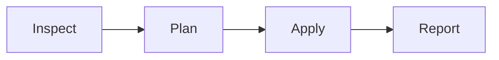

# Hub janitor graph (draft)

Status: draft, not implemented (the loop skeleton it relies on is, see the
loop design). The first loop in
[the loop design](design-loop.md#12-first-loop-hub-housekeeping-proposal): a graph
that checks the hub's health and reports, then optionally removes, what the hub
and graphs leave behind. It uses no model, no GitHub and no write token, and runs
in a normal hub slot. Executor, topology and plugin facts below come from the
current docs and sources; details marked **verify** are to be confirmed against
the code when it is built.

## 1. Decisions already made

- A graph, not hub core; takes one of the hub's run slots, no exemption.
- **Report-only first.** `apply` is false until the profile sets it.
- Only GraphLoom-owned things are ever removed.
- **Run history is part of the job** (operator, 2026-11-27): the janitor keeps the
  hub's terminal run records from piling up (section 7).
- The loop starts it daily: run key `loop:hub-housekeeping:day:<yyyy-mm-dd>:0`
  (the loop's `<subject>` is `day:<yyyy-mm-dd>`).

## 2. The real constraint: where the effects run

A graph plugin is pure, and ordinary command jobs run confined in a run's own
worktree. They cannot see the host's Docker socket or other runs' worktrees,
which is the point of the confinement. So the janitor cannot be "a graph of
`docker system prune` command jobs". The split is:

| Part | Owns |
|---|---|
| Graph plugin `hub-janitor` | Decides, from observations, what is a candidate and what to remove; records the plan; checks the apply matched it. Pure |
| Executor `graphloom.hub-maintenance` (new, built-in package) | Performs a small set of **typed, fixed operations** on the host. No arbitrary argv |
| Runner config | Grants the executor: it needs `isolation: "unrestricted"` and the operator's `allowUnrestricted` (the existing gate in `packages/runner/src/builtin.ts`) |

The executor's narrowness is the safety property. The graph cannot ask it to run
a command or to delete a path outside the hub's own directories.

### Executor operations (each reports a bounded, structured result)

| Operation | Effect | Notes |
|---|---|---|
| `hub-health` | Reads hub status and `doctor`-equivalent facts | Read only |
| `docker-health` | CLI present, daemon reachable | Read only; absent Docker is a result, not an error |
| `disk-usage` | Bytes and free space for the hub dir and run dirs | Read only |
| `docker-list` | GraphLoom-labelled containers, volumes, images (`graphloom.run` label), with age and run id | Read only |
| `run-inventory` | Runs known to the hub and their state, from the hub's read API (open point 2), not by scanning files | Read only |
| `hub-archive` | Archive one named submission through the hub's typed `archive` command (`POST /v1/submissions/:id/commands`) | Section 7: the hub itself refuses a submission that is not terminal and drained; the executor re-reads its state first; the command id is derived from the run id and plan so a retry is idempotent |
| `docker-remove` | Remove the named objects | Refuses any object lacking the GraphLoom label, or whose run is not terminal, re-checked at the moment of removal |
| `hub-purge` | Purge one archived submission's run files through `POST /v1/submissions/:id/purge` (`hub purge`), `dryRun` unless the plan is applied; never `force` | Section 7, layer 2: the hub refuses a live submission, a run a live controller owns, a worktree with uncommitted changes or a branch with extra commits |
| `versions-prune` | The installer's `self prune` rules | Deferred to a later version of the janitor; not in v1 |

Every removal operation takes the ids from the plan and **re-verifies the
precondition itself**; the plan is advice, the executor is the authority.

## 3. Graph



Linear, four nodes, `Report` terminal. No edges back, no supervisor-only node.

| Node | Requirement | Behaviour |
|---|---|---|
| Inspect | `observations-complete` | Runs the read-only operations. A failed probe (daemon down, disk low) is recorded **as a finding**, not a graph failure; the run still advances |
| Plan | `plan-recorded` | Pure function of the observations and the profile: candidates (labelled objects older than `docker.minAgeHours` whose run is terminal; archived runs older than `history.purgeAfterDays`, section 7) and the run history to archive (section 7), each with a reason |
| Apply | `apply-matches-plan` | `apply: false`: records "report-only, nothing removed or archived" and passes. `apply: true`: calls the removal operations with the plan's ids; the requirement passes when every item is removed or refused with the executor's reason, and nothing outside the plan was touched |
| Report | `report` | A bounded summary: findings, candidates, removed, refused, bytes reclaimed (or reclaimable in report-only), duration |

**Findings are results.** A degraded hub (Docker down, low disk) should reach the
operator as a report, not as a stopped run that wakes the supervisor to "repair"
a plugin that did nothing wrong. A run stops only for what stops any graph: the
executor is not granted (`allowUnrestricted` missing; the operator fixes the
runner config), budgets exhausted, or an executor protocol fault. Budgets are
set to zero agent invocations, so the supervisor has nothing to spend and an
unexpected stop goes to the operator.

## 4. Profile

```jsonc
{
  "name": "hub-janitor",
  "apply": false,                         // report-only until the operator sets true
  "docker": { "minAgeHours": 24 },        // GraphLoom-labelled objects only
  "health": { "minFreeDiskGiB": 10 },
  "history": {                            // section 7; each age in days
    "archiveSucceededAfterDays": 14,
    "archiveCanceledAfterDays": 14,
    "archiveFailedAfterDays": 30,         // failed runs keep their evidence for triage longest
    "archiveRehearsalsAfterDays": 1,
    "archiveJanitorRunsAfterDays": 7,
    "purgeAfterDays": 90,                 // layer 2: an archived run's files, counted from archivedAt
    "maxArchivesPerRun": 50,
    "maxPurgesPerRun": 20
  },
  "limits": { "maxRemovalsPerRun": 50, "maxBytesPerRun": "20g" },
  "loop": {}                              // present, so the profile can be looped; the schedule is the loop file's `every: 1d`
}
```

`loopCandidates({ profile, now })` returns one candidate per day: subject
`day:<yyyy-mm-dd>` from `now`, `taskArgs` empty. Because the key is time-based, a failed or blocked day stays reserved and the
next day gets a fresh one; it is not rerun (loop design, decision 4).

## 5. Safety

- **Ownership by label.** Docker objects are removed only if they carry the
  runner's `graphloom.run` label (and, when present, `graphloom.op`) and the
  run id resolves to a terminal run. Unlabelled objects, `docker system prune`
  and `docker image prune -a` are never used.
- **Never remove evidence of an unfinished story.** Live, blocked, waiting,
  paused and **failed** runs keep their worktrees until archived and then
  purged on age; failed evidence is for the operator's triage, so a failed run is
  archived after 30 days and purged `purgeAfterDays` later, never sooner.
- **Caps** per run (`maxRemovalsPerRun`, `maxBytesPerRun`); exceeding one stops
  applying and reports "more remains".
- **Two keys to delete.** Removal needs `apply: true` in the profile *and* the
  executor grant; either alone does nothing.
- **Idempotent and re-runnable.** Removal of an already-gone object is a success
  with a note. A run killed mid-Apply is reconciled by re-observing, not by
  retrying blindly, as the controller does.
- **No secrets.** It receives no credentials; reads only local state.

## 6. Open points

1. **Task repository: loosen intake (decided direction, to be designed).**
   Today `intakeTask` requires `repo` (`parseTaskYaml`: "task.yaml must declare
   graph, repo, and request"), an existing directory inside a git repository
   with a resolvable `HEAD`. A graph is not bound to a repository, so intake
   should not demand one. But `repoPath`, `pinnedHead` and `worktreePath` run
   through about twenty-five source files (controller intake, checkout,
   admit, reconcile, delete-run, managed binding; the hub's input, store and
   archive; the executor assignment; the CLI) and are persisted in
   `state.json` and the hub's `scheduler.json`, whose formats have migration
   fixtures. Making them optional everywhere is a wide, risky change.
   **Proposal: loosen only the operator-facing rule.** The bundle's manifest
   declares `repository: "required" | "optional" | "none"` (default
   `required`, so every existing graph is unchanged), the way it declares
   `taskConfig`. For `none`, `repo` may be omitted, and intake has the
   controller create a private empty git repository with one empty commit
   inside the run's own state directory and pins that. Downstream code sees an
   ordinary repository, persisted formats do not change, and nobody keeps a
   scratch repository. Intake refuses `repo` for `none` and refuses its absence
   for `required`. `hub-janitor` declares `none`. **Verify** against `intake.ts`,
   `managed.ts`, `hub-input.ts` (which links `repo` into the submission) and
   `delete-run.ts` (the branch-owner check) before building; the controller
   owning that repository changes where "delete" and "release worktree" operate.
   **Beyond `none`: a folder as the workspace (`optional`).** For a graph that
   works on a directory that is not a git repository (list its files, say),
   `repository: "optional"` lets the task name `repo:` as any directory:
   - A git repository behaves as today (pinned `HEAD`, worktree).
   - A plain folder is **snapshotted**: intake copies it into the run's state
     directory under the controller's own private git repository and commits it
     once, then pins that. The graph sees an isolated copy, so nothing escapes
     the worktree confinement and downstream code, persisted formats and
     replay are unchanged. Caps are explicit and refuse rather than truncate:
     maximum file count and total bytes (defaults in the runner config), symlinks
     refused or kept as links never followed, no files outside the folder, and
     `.git` of an enclosing repository ignored. The snapshot's digest is
     pinned like `HEAD`, so a resume sees the same bytes.
   - Alternative, not proposed: mount the live folder read-only into the
     executor. It shows current files, but needs a new confinement scope (a
     host path outside the worktree), is not replayable (the folder changes
     between resumes), and weakens the pinned-input rule. A graph that needs
     live host state uses an unrestricted executor like `graphloom.hub-maintenance`,
     granted by the operator.
   Pull request order: `none` first (the janitor needs it); `optional` with
   snapshots after, when a graph needs it.
2. **Run inventory source (checked).** The hub's read API (`GET /v1/health` and
   the status reply, `packages/sdk/src/hub.ts`) lists submissions with
   `runId`, scheduling state (`succeeded`, `failed`, `canceled` are terminal),
   launch and blocker, plus archive entries with `state`, `settledAt` and
   `stateDir`. It does **not** give a live submission's worktree path or its
   age beyond timestamps. For v1 this is enough: Docker candidates are matched
   to runs by the `graphloom.run` label's run id and the run's scheduling
   state, and worktree candidates are reported by run id and `settledAt`, with
   no path needed because v1 removes nothing there. Removal later needs the
   path from a controller operation (point 3), not from scanning files.
3. **Removing a worktree (resolved).** A run's worktree is a registered git
   worktree plus a branch in the task repository, not a plain directory, and
   `graphloom delete` refuses hub-managed runs. `hub purge` (#373, run hub §4.3)
   is the supported operation for a finished managed run once it is archived:
   it removes the worktree, branch, ownership record and state directory under
   the run's lock and refuses uncommitted changes or extra commits without
   `force`. The janitor archives first (layer 1), then purges after a longer
   age (layer 2). Nothing here reimplements deletion. A finished run's worktree
   therefore lives `archive age + purge age`, and a Triage-refused issue's run
   (loop design, open item 3) is cleaned the same way.
4. **Whose cleanup for archived runs' artifacts?** `hub archive` keeps run
   artifacts by design, and `graphloom hub purge`
   ([run hub §4.3](design-run-hub.md#43-purging-an-archived-submissions-run-files))
   now removes an archived run's state directory, worktree and branch (per
   submission, with a dry run). The janitor calls it rather than reimplementing
   it (section 7, layer 2). It never passes `force`, and never removes
   `state.json` history from the archive index or an idempotency tombstone.
5. **Docker rootless vs rootful.** Rootful needs the `docker` group, which is
   root-equivalent; the executor's grant is then as strong as that. Document
   it; prefer rootless.

## 7. Run history cleanup

What piles up in the hub: terminal submissions stay in the queue record until an
operator archives them (design-run-hub 4: "an explicit archive operation");
rehearsals, the janitor's own daily runs and every loop-started run add to it.
The queue record is bounded (10,000 retained submissions, a 16 MiB snapshot),
and at the cap the hub refuses new submissions, so unattended loops need this
cleanup to keep running. Three layers, by risk:

| Layer | What | Effect | When |
|---|---|---|---|
| 1. Archive | A terminal, drained submission older than its age in `history` | Moves its record out of the queue into the bounded archive index; **keeps** run artifacts (worktree, evidence, state) and the idempotency tombstone | v1, uses the hub's existing `archive` command |
| 2. Purge | An archived run's worktree, branch, evidence and state directory, `history.purgeAfterDays` (default 90) after it was archived | Frees disk; the hub marks the archive index entry `purgedAt` and keeps the idempotency tombstone | v1, uses the hub's existing `hub purge` (run hub §4.3); a dry run first |
| 3. Bounds | The archive index (5,000 entries, 8 MiB) and tombstones | The hub's own retention evicts the oldest index entries | Not the janitor's job |

**Never touched, by design.**
- **Tombstones.** An archived key stays reserved for the life of the hub store
  (design-run-hub 4), "no automatic retention policy makes an old submission
  eligible to run again". The loop's duplicate guard depends on it: the engine
  skips a key that is archived ("archived; not restarted"). Archiving does not
  free a key, so it cannot make a loop restart an old issue. A janitor feature
  that pruned tombstones would break the loop and is out of scope.
- Non-terminal submissions: `queued`, `starting`, `running`, `stopping`,
  `waiting`, `paused` and `blocked` (a blocker needs the operator).
- A submission whose launch has not drained.

**Per-state ages** (profile `history`): succeeded and canceled 14 days, **failed
30 days** (its evidence is what triage reads; the longest), rehearsal
submissions 1 day (they exist to be thrown away), the janitor's own runs 7 days.
Age is `settledAt`, the terminal record's last update. Failed runs that an
operator has not looked at are the case to watch: 30 days is a default, and an
operator who wants failed runs kept longer raises it.

**How it runs.** Plan lists the candidates from `run-inventory` (state,
`settledAt`, graph, rehearsal flag, drained) with a reason each. Apply calls
`hub-archive` for each planned id, at most `maxArchivesPerRun` per run; the
executor re-reads the submission's state immediately before and the hub refuses
anything not terminal and drained, so a plan made earlier cannot archive a run
that was resumed since. A command id derived from the run id and operation id
makes a retry idempotent. Report-only first, as everything else here: with
`apply: false` the report lists what it would archive and how old each is.

**What the operator reads.** The Report node lists archived (or would-archive)
submissions by state and age, how many were skipped and why (not drained, too
young, cap reached), the queue size before and after, and the queue's remaining
headroom against the 10,000 cap.

**Cost to remember.** Each janitor run is itself a hub submission, so it adds a
record daily and archives its own predecessors after 7 days.

## 8. Verification plan

- Plan: table-driven pure tests (age, label, run state, caps, per-state ages, rehearsal and janitor-run ages, drained or not) with no Docker.
- History: a fake hub API; archiving never touches a non-terminal or undrained submission; a plan made before a resume is refused at apply; a retry with the same command id archives once; the loop engine still treats an archived key as reserved (a `decide` test with an archived known key); `maxArchivesPerRun` stops applying.
- Executor: fake Docker CLI and a temporary hub directory; every refusal (no
  label, live run, path escape, failed run) and the re-verification at removal.
- Graph: scripted-executor tests for each node, report-only vs apply, findings
  not stopping the run, and the unrestricted-not-granted stop.
- Rehearsal: `hub submit --rehearsal` through the hub with stand-ins (a shipped
  scenario, like every other graph).
- Live, once, by the operator, with `apply: false`: review the first reports
  before setting `apply: true`.
