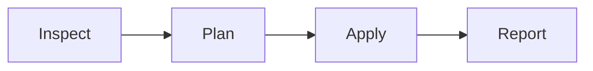

# Hub janitor graph (draft)

Status: draft, not implemented (the loop skeleton it relies on is, see the
loop design). The first loop in
[the loop design](design-loop.md#12-first-loop-hub-housekeeping-proposal): a graph
that checks the hub's health and reports, then optionally removes, what the hub
and graphs leave behind. It uses no model, no GitHub and no write token, and runs
in a normal hub slot. Executor, topology and plugin facts below come from the
current docs and sources; details marked **verify** are to be confirmed against
the code when it is built.

## 1. Decisions already made

- A graph, not hub core; takes one of the hub's run slots, no exemption.
- **Report-only first.** `apply` is false until the profile sets it.
- Only GraphLoom-owned things are ever removed.
- The loop starts it daily: run key `loop:hub-housekeeping:day:<yyyy-mm-dd>:0`
  (the loop's `<subject>` is `day:<yyyy-mm-dd>`).

## 2. The real constraint: where the effects run

A graph plugin is pure, and ordinary command jobs run confined in a run's own
worktree. They cannot see the host's Docker socket or other runs' worktrees,
which is the point of the confinement. So the janitor cannot be "a graph of
`docker system prune` command jobs". The split is:

| Part | Owns |
|---|---|
| Graph plugin `hub-janitor` | Decides, from observations, what is a candidate and what to remove; records the plan; checks the apply matched it. Pure |
| Executor `graphloom.hub-maintenance` (new, built-in package) | Performs a small set of **typed, fixed operations** on the host. No arbitrary argv |
| Runner config | Grants the executor: it needs `isolation: "unrestricted"` and the operator's `allowUnrestricted` (the existing gate in `packages/runner/src/builtin.ts`) |

The executor's narrowness is the safety property. The graph cannot ask it to run
a command or to delete a path outside the hub's own directories.

### Executor operations (each reports a bounded, structured result)

| Operation | Effect | Notes |
|---|---|---|
| `hub-health` | Reads hub status and `doctor`-equivalent facts | Read only |
| `docker-health` | CLI present, daemon reachable | Read only; absent Docker is a result, not an error |
| `disk-usage` | Bytes and free space for the hub dir and run dirs | Read only |
| `docker-list` | GraphLoom-labelled containers, volumes, images (`graphloom.run` label), with age and run id | Read only |
| `run-inventory` | Runs known to the hub and their state, from the hub's read API (open point 2), not by scanning files | Read only |
| `docker-remove` | Remove the named objects | Refuses any object lacking the GraphLoom label, or whose run is not terminal, re-checked at the moment of removal |
| `worktree-remove` | Release the worktree and branch of the named terminal run | **Not in v1**, see open point 3: needs a new controller operation first |
| `versions-prune` | The installer's `self prune` rules | Deferred to a later version of the janitor; not in v1 |

Every removal operation takes the ids from the plan and **re-verifies the
precondition itself**; the plan is advice, the executor is the authority.

## 3. Graph



Linear, four nodes, `Report` terminal. No edges back, no supervisor-only node.

| Node | Requirement | Behaviour |
|---|---|---|
| Inspect | `observations-complete` | Runs the read-only operations. A failed probe (daemon down, disk low) is recorded **as a finding**, not a graph failure; the run still advances |
| Plan | `plan-recorded` | Pure function of the observations and the profile: candidates (labelled objects older than `docker.minAgeHours` whose run is terminal; terminal runs' worktrees older than `worktrees.minAgeDays` that are succeeded or archived; v1 lists these as report-only candidates and never removes them), each with a reason |
| Apply | `apply-matches-plan` | `apply: false`: records "report-only, nothing removed" and passes. `apply: true`: calls the removal operations with the plan's ids; the requirement passes when every item is removed or refused with the executor's reason, and nothing outside the plan was touched |
| Report | `report` | A bounded summary: findings, candidates, removed, refused, bytes reclaimed (or reclaimable in report-only), duration |

**Findings are results.** A degraded hub (Docker down, low disk) should reach the
operator as a report, not as a stopped run that wakes the supervisor to "repair"
a plugin that did nothing wrong. A run stops only for what stops any graph: the
executor is not granted (`allowUnrestricted` missing; the operator fixes the
runner config), budgets exhausted, or an executor protocol fault. Budgets are
set to zero agent invocations, so the supervisor has nothing to spend and an
unexpected stop goes to the operator.

## 4. Profile

```jsonc
{
  "name": "hub-janitor",
  "apply": false,                         // report-only until the operator sets true
  "docker": { "minAgeHours": 24 },        // GraphLoom-labelled objects only
  "worktrees": { "minAgeDays": 14, "states": ["succeeded"] },
  "health": { "minFreeDiskGiB": 10 },
  "limits": { "maxRemovalsPerRun": 50, "maxBytesPerRun": "20g" },
  "loop": {}                              // present, so the profile can be looped; the schedule is the loop file's `every: 1d`
}
```

`loopCandidates({ profile, now })` returns one candidate per day: subject
`day:<yyyy-mm-dd>` from `now`, `taskArgs` empty. Because the key is time-based, a failed or blocked day stays reserved and the
next day gets a fresh one; it is not rerun (loop design, decision 4).

## 5. Safety

- **Ownership by label.** Docker objects are removed only if they carry the
  runner's `graphloom.run` label (and, when present, `graphloom.op`) and the
  run id resolves to a terminal run. Unlabelled objects, `docker system prune`
  and `docker image prune -a` are never used.
- **Never remove evidence of an unfinished story.** Live, blocked, waiting,
  paused and **failed** runs keep their worktrees; failed evidence is for the
  operator's triage.
- **Caps** per run (`maxRemovalsPerRun`, `maxBytesPerRun`); exceeding one stops
  applying and reports "more remains".
- **Two keys to delete.** Removal needs `apply: true` in the profile *and* the
  executor grant; either alone does nothing.
- **Idempotent and re-runnable.** Removal of an already-gone object is a success
  with a note. A run killed mid-Apply is reconciled by re-observing, not by
  retrying blindly, as the controller does.
- **No secrets.** It receives no credentials; reads only local state.

## 6. Open points

1. **Task repository: loosen intake (decided direction, to be designed).**
   Today `intakeTask` requires `repo` (`parseTaskYaml`: "task.yaml must declare
   graph, repo, and request"), an existing directory inside a git repository
   with a resolvable `HEAD`. A graph is not bound to a repository, so intake
   should not demand one. But `repoPath`, `pinnedHead` and `worktreePath` run
   through about twenty-five source files (controller intake, checkout,
   admit, reconcile, delete-run, managed binding; the hub's input, store and
   archive; the executor assignment; the CLI) and are persisted in
   `state.json` and the hub's `scheduler.json`, whose formats have migration
   fixtures. Making them optional everywhere is a wide, risky change.
   **Proposal: loosen only the operator-facing rule.** The bundle's manifest
   declares `repository: "required" | "optional" | "none"` (default
   `required`, so every existing graph is unchanged), the way it declares
   `taskConfig`. For `none`, `repo` may be omitted, and intake has the
   controller create a private empty git repository with one empty commit
   inside the run's own state directory and pins that. Downstream code sees an
   ordinary repository, persisted formats do not change, and nobody keeps a
   scratch repository. Intake refuses `repo` for `none` and refuses its absence
   for `required`. `hub-janitor` declares `none`. **Verify** against `intake.ts`,
   `managed.ts`, `hub-input.ts` (which links `repo` into the submission) and
   `delete-run.ts` (the branch-owner check) before building; the controller
   owning that repository changes where "delete" and "release worktree" operate.
   **Beyond `none`: a folder as the workspace (`optional`).** For a graph that
   works on a directory that is not a git repository (list its files, say),
   `repository: "optional"` lets the task name `repo:` as any directory:
   - A git repository behaves as today (pinned `HEAD`, worktree).
   - A plain folder is **snapshotted**: intake copies it into the run's state
     directory under the controller's own private git repository and commits it
     once, then pins that. The graph sees an isolated copy, so nothing escapes
     the worktree confinement and downstream code, persisted formats and
     replay are unchanged. Caps are explicit and refuse rather than truncate:
     maximum file count and total bytes (defaults in the runner config), symlinks
     refused or kept as links never followed, no files outside the folder, and
     `.git` of an enclosing repository ignored. The snapshot's digest is
     pinned like `HEAD`, so a resume sees the same bytes.
   - Alternative, not proposed: mount the live folder read-only into the
     executor. It shows current files, but needs a new confinement scope (a
     host path outside the worktree), is not replayable (the folder changes
     between resumes), and weakens the pinned-input rule. A graph that needs
     live host state uses an unrestricted executor like `graphloom.hub-maintenance`,
     granted by the operator.
   Pull request order: `none` first (the janitor needs it); `optional` with
   snapshots after, when a graph needs it.
2. **Run inventory source (checked).** The hub's read API (`GET /v1/health` and
   the status reply, `packages/sdk/src/hub.ts`) lists submissions with
   `runId`, scheduling state (`succeeded`, `failed`, `canceled` are terminal),
   launch and blocker, plus archive entries with `state`, `settledAt` and
   `stateDir`. It does **not** give a live submission's worktree path or its
   age beyond timestamps. For v1 this is enough: Docker candidates are matched
   to runs by the `graphloom.run` label's run id and the run's scheduling
   state, and worktree candidates are reported by run id and `settledAt`, with
   no path needed because v1 removes nothing there. Removal later needs the
   path from a controller operation (point 3), not from scanning files.
3. **Removing a worktree (checked, and it changes the design).** A run's
   worktree is a registered git worktree plus a branch in the task repository,
   not a plain directory. `deleteRun` (`graphloom delete`) removes the worktree,
   the branch and then the state directory, but it **refuses hub-managed runs**
   ("archive it through the hub"), and `hub archive` keeps artifacts by design.
   So no existing operation removes a hub-managed finished run's worktree, and
   plain `rm` would leave it registered. `worktree-remove` must not reimplement
   this. Options: (a) add a controller operation, "release a finished managed
   run's worktree and branch, keep `state.json` and evidence", used by the
   executor; (b) leave worktrees out of v1 and clean only Docker objects.
   Recommendation: (b) for v1, then (a) as its own change with its own tests.
   Note the loop design's open item 3: issue-fix's Triage step leaves one
   worktree per refused issue, so (a) is more urgent than the janitor alone
   suggests.
4. **Whose cleanup for archived runs?** `hub archive` keeps run artifacts by
   design; the operator now removes an archived run's state directory, worktree
   and branch with `graphloom hub purge`
   ([run hub §4.3](design-run-hub.md#43-purging-an-archived-submissions-run-files)),
   which a later janitor version could call instead of reimplementing it; deleting
   them from the graph is a decision beyond v1. v1 removes only Docker objects (point 3
   defers worktrees), and never `state.json`, evidence or the archive index.
5. **Docker rootless vs rootful.** Rootful needs the `docker` group, which is
   root-equivalent; the executor's grant is then as strong as that. Document
   it; prefer rootless.

## 7. Verification plan

- Plan: table-driven pure tests (age, label, run state, caps) with no Docker.
- Executor: fake Docker CLI and a temporary hub directory; every refusal (no
  label, live run, path escape, failed run) and the re-verification at removal.
- Graph: scripted-executor tests for each node, report-only vs apply, findings
  not stopping the run, and the unrestricted-not-granted stop.
- Rehearsal: `hub submit --rehearsal` through the hub with stand-ins (a shipped
  scenario, like every other graph).
- Live, once, by the operator, with `apply: false`: review the first reports
  before setting `apply: true`.
