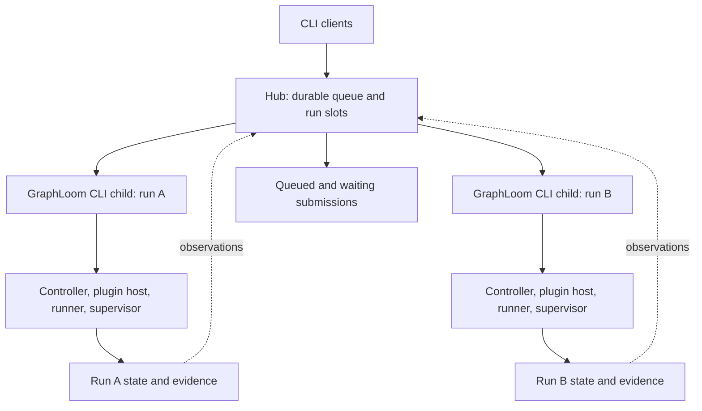

# GraphLoom run hub

Status: implemented in this worktree, with deployment qualification outstanding.
The local CLI, durable scheduler, managed controller/runner contract, reusable
panels and terminal watch are connected. This extends the
[core design](design-typescript-core.md) without changing graph topology,
acceptance, supervisor authority or run budgets.

The [throwaway panel prototype](../apps/graphloom/prototype-monitor-panels/README.md)
remains a fictional visual-review artifact. Production rendering now lives in
`packages/monitor`: text, ANSI, JSON and bounded Markdown/KaTeX, ELK topology with
complete adjacency fallback, and quantitative cell charts. Tests use fake
process drivers, real gated child processes with cgroup filesystem fixtures,
scripted controller runs and renderer fixtures. Real delegated
systemd/cgroup/container stop/restart qualification and deployed HAPI assistant
color qualification remain operational checks; no service was deployed as part
of implementation. Unknown chat hosts use plain output.

## 1. Outcome and scope

An operator starts one daemon and sets `maxConcurrentRuns`. Users submit tasks;
the hub queues them, starts GraphLoom CLI child processes when slots are available,
reports progress and resource use, and schedules eligible resumptions. A submission
keeps the same run ID across every resume. The queue survives daemon and machine
restarts.

The first version serves trusted users acting through one Linux account, on one
machine, through a Unix socket. Separate Unix accounts can run separate hubs with
separate credentials and limits. Network access, tenant isolation, multiple
machines, graph dependencies, and a web interface are later work. Existing direct
`graphloom run` remains available and outside the hub's limit; the limit is global
to one hub, not a machine-wide limit on arbitrary processes.

Monitoring means run status, stage progress, and resource usage: recorded model
calls, tokens and cost when available, budget consumption, elapsed/active time,
and process CPU/memory with explicit measurement coverage.
Usage rates supplement those totals. Provider cooldowns remain visible as waiting
states used by automatic continuation; enforcing provider rate limits is outside
the requested scope. The concurrency limit controls how many runs execute at once.

## 2. Ownership and package seam



| Module | Owns |
| --- | --- |
| New `packages/hub` | Submissions, slot admission, launch journal, retry timing, process lifetime, hub observations |
| `apps/graphloom` | `hub` commands, socket transport, installed-version dispatch, managed child bootstrap |
| `packages/controller` | Run initialization, lock and ownership, evidence, receipts, budgets, reconciliation, structured continuation eligibility |
| `packages/runner` | Jobs, sandboxing, executor children and external execution cleanup |
| `packages/supervisor` | Investigation and recovery within a run |

The hub is a deep module: callers submit, inspect, and control submissions without
coordinating processes, persistence, or timers. Its private scheduler and process
adapter are tested through that interface. Graph plugins never import the hub;
they do not know whether their controller was started by a terminal or a daemon.

The hub never writes `state.json`, synthesizes receipts, edits a stopped run's
budgets, or diagnoses graph failures with another agent. It requests operations
from the CLI version that owns the run. Existing pinning and upgrade rules apply.

## 3. Operator interface

The CLI provides:

```sh
graphloom hub serve --config ~/.config/graphloom/hub.json
graphloom hub status
graphloom hub submit ./tasks/fix/task.yaml --key fix-14169
graphloom hub list
graphloom hub list --state blocked --state failed --since 3d
graphloom hub list --archived --repo widgets --grep "crash" --limit 20
graphloom hub watch
graphloom hub watch <submission> --plain
graphloom hub inspect <submission>
graphloom hub inspect <submission> --panel topology --format text
graphloom hub inspect <submission> --panel topology --format ansi
graphloom hub inspect <submission> --panel overview --format markdown --chat-renderer katex
graphloom hub inspect <submission> --panel topology --stage review
graphloom hub inspect <submission> --panel job --follow-current
graphloom hub watch <submission> --panel usage
graphloom hub logs <submission> --follow
graphloom hub limit 3
graphloom hub pause <submission>
graphloom hub resume <submission>
graphloom hub cancel <submission>
graphloom hub archive <submission>
```

`graphloom --help` lists every hub command; `graphloom hub --help` lists them
alone, and `graphloom hub <command> --help` prints one command's usage and a
short description. `inspect` and `watch` take `--stage <stage>` (narrow the
topology and job panels to one stage's neighbourhood) and `--follow-current`
(select the current stage's running job instead of naming one with `--job`).

`submit` returns immediately after durable acceptance with `submissionId`, the
reserved `runId`, queue position, and a reference usable by `hub inspect`.
`--key` is an optional idempotency key: the same key and request return the same
submission; different input with that key is a conflict. Without a key, submitting
the same task twice deliberately creates two runs. The CLI always generates and
prints a key **before its first request** unless `--key` supplies one, and reuses
it after an uncertain response. A new invocation gets a new key. Raw API clients
may omit a key, but cannot safely retry an uncertain unkeyed submission.

`pause` records a hold and requests a cooperative stop if active. It returns the
new desired state immediately; `inspect` shows `stopping` until cleanup finishes.
`resume` removes a hold or requests another attempt and joins the queue. It never
bypasses capacity. `cancel` permanently withdraws the submission and drains any
active execution; it retains run state and worktree. Continuing a canceled task
requires a new submission. `limit 0` stops new admissions and lets current runs
finish. Lowering a limit never kills an existing run.

`hub resume` also accepts explicit operator remedies already supported by ordinary
resume: approval inputs, reconciliation acknowledgement, and plugin, executor or
product upgrades. They are stored as a typed, single-use command and applied by
the owning CLI under the run lock. Automatic resume supplies none of these.
Replies distinguish an accepted command from a completed run transition.

Example configuration:

```json
{
  "maxConcurrentRuns": 2,
  "retry": {
    "automatic": true,
    "maxAutomaticResumes": 5,
    "maxElapsedMs": 86400000,
    "baseDelayMs": 30000,
    "maxDelayMs": 1800000
  },
  "pollIntervalMs": 5000,
  "shutdownGraceMs": 60000
}
```

The elapsed retry window starts at the first automatic-resume-eligible failure.
Limits and defaults are copied into each submission at acceptance. Changing the
hub default affects future submissions; an explicit policy update is required for
existing ones. `hub limit` persists the global limit immediately. The config seeds
it on first creation; subsequent starts use the durable value and report it.

### 3.1 Status and history search

`graphloom hub status [--json]` reads `GET /v1/health`: hub ID, socket, the running
hub's GraphLoom version, the limit, occupied slots, per-state submission counts,
the archive index's size, and any fault, retention, monitoring or archive-index
error. It is the reachability check for scripts and agent skills: exit 0 when the
hub answers without a fault, 1 when nothing answers on the socket, 3 when it
answers with a persistence fault or is shutting down. A retention, monitoring or
archive-index error is printed but keeps exit 0; admission still works. `--json`
prints the health object with `reachable` and `healthy` booleans and the
submission count in place of the records; unreachable prints
`{"reachable": false, "healthy": false, "socket", "error"}`.

`graphloom hub list` without flags lists the retained queue in queue order. Any
search flag turns it into a history search over the same records, newest
acceptance first:

| Flag | Matches |
| --- | --- |
| `--state <s>` | Repeatable; any of the scheduling states (an archived entry's final state) |
| `--graph <id>` | The task's graph, read from the captured task |
| `--repo <path-or-substring>` | An argument starting with `/`, `.` or `~` is resolved (and real-pathed) by the CLI and matches the repository exactly; anything else is a substring of its path |
| `--key <substring>` | A substring of the idempotency key |
| `--since`, `--until` | Inclusive bounds on acceptance time: an ISO time, or a duration before now (`90s`, `10m`, `2h`, `3d`, `1w`) resolved by the CLI |
| `--grep <text>` | Case-insensitive text in the request or the blocker; a live submission's whole request, an archived entry's first line |
| `--limit <n>` | At most `n` rows (1 to 10,000) after sorting; `matched` reports the count before it |
| `--archived` | Also search the archive index (§4.1) |

The filters combine with AND. The search runs in the hub
(`GET /v1/submissions?state=…&graph=…&archived=true`); the reply keeps the list
shape, with live matches in `submissions`, a `summaries` map of each match's
graph, request digest and request first line, archive matches in `archived`, and
`matched`. The plain reply without parameters is unchanged. The hub reads each
captured task once (they are immutable) to know its graph and request; an
unreadable task matches no graph and no request text.

## 4. Submission inputs and durable state

Submission captures task bytes, config bytes, canonical repository and bundle
paths, the resolved base commit, bundle identity/digests, and the chosen runtime
configuration reference and non-secret digest. The hub materializes a private task
with valid relative paths or links, using the same intake rules as `task new`.
Queueing must not silently change the requested base when repository HEAD moves.
The task/config copies are immutable; a bundle or runtime configuration that has
changed before initial admission blocks the submission for explicit replacement.
Intake rechecks identities before any graph job starts. Credentials remain in the
operator's existing stores; the queue does not copy secret values.

Read-only input preparation can run before slot admission. Plugin callbacks,
rehearsals, worktree creation and all execution belong inside the reservation.
The hub does not prepare a graph-specific task from a forge reference: the user
can use the existing `graphloom task new` before submitting it.

Use a local filesystem and one versioned `scheduler.json` containing configuration,
submissions, idempotency keys, queue sequence, command records and launch intents.
The hub holds a kernel lock for its whole lifetime; every mutation goes through
one serialized writer. Write a complete temporary snapshot, fsync it, rename it,
and fsync its parent before acknowledging a command or allowing a child to work.
Do not inherit the lock descriptor into children. This follows the project's
existing file-based persistence without introducing a database for one writer.

Immutable submission inputs are written and synced before the snapshot references
them. Orphan input directories can be reported after a crash; they are never
treated as accepted submissions. Mutable telemetry and rotated process logs live
separately. Snapshot schema migrations run exclusively before scheduling; a newer
unknown format refuses startup. Invalid state is a reported fault, not an empty
queue. Bound the snapshot to 16 MiB and 10,000 retained submissions; reserve 2 MiB
for global lifecycle metadata. Admission accounts for each submission's maximum
bounded operational record size, not its current size, so every accepted entry
has space for a launch, a pending operator command, and its cleanup/result state.
All strings, command inputs and history summaries have schema bounds. Completed
launch/command history is checkpointed into per-submission journals, with only
bounded summaries and a committed cursor in the snapshot. Journal bytes are
synced before the snapshot advances its cursor; unreferenced suffixes after a
crash do not count as accepted commands. Old command IDs remain deduplicated from
the committed journal. Refuse new submissions before consuming lifecycle reserves,
and never discard unsettled intent to compact history. Pause, cancel, drainage
and settlement remain writable at the admission cap. Actual disk exhaustion stops
new work and reports the persistence failure; it cannot be solved by a logical
capacity reservation. An explicit archive operation removes
terminal queue records while retaining run artifacts, compact idempotency
tombstones in the snapshot, and a history entry in the archive index (§4.1). A tombstone records the key, request digest and original
submission/run IDs: a matching request returns an archived result, never a new run.
The same 16 MiB cap applies; refuse new keys if it is reached. Keys remain reserved
for the lifetime of this hub store. No automatic retention policy makes an old
submission eligible to run again.

The scheduling record has two independent axes:

| Field | Values and meaning |
| --- | --- |
| Desired action | `execute`, `hold`, `cancel`; only an operator command changes a hold/cancel |
| Scheduling state | `queued`, `starting`, `running`, `stopping`, `waiting`, `paused`, `blocked`, `succeeded`, `failed`, `canceled` |
| Run observation | Controller status, revision, stage, attempts, stop/continuation information; read-only and timestamped |
| Launch | Generation, reservation, process identity, cgroup, command identity, launch/exit/cleanup observations |

`blocked` means a human decision, changed input, reconciliation, or renewed retry
allowance is needed. `failed` is a terminal controller failure or unrecoverable
initialization failure. Waiting and blocked submissions can have no live process.
A scheduling label alone never releases a reservation.

### 4.1 Archive index

Archiving a submission first adds one entry to `archive-index.json` beside
`scheduler.json`, then commits the snapshot without the queue record. The entry
holds the submission and run IDs, idempotency key, graph, repository path,
original task path, the submission's request digest, the request's own SHA-256
and first nonblank line (at most 200 characters), acceptance, settlement (the
terminal record's last update) and archive times, the final state, the run's
state directory (`<hub directory>/runs/<runId>`) and the last blocker (at most
512 characters). Graph, request and state directory come from the captured task
and the hub runtime; when they cannot be read the entry omits them and the
archive still proceeds. An entry that still exceeds 16 KiB keeps only its
identity, times, state and clipped paths.

The index is history, not authority. Tombstones alone reserve keys and answer
repeated submissions; evicting an index entry never makes a request runnable
again. Retention is bounded: the newest 5,000 entries and at most 8 MiB, the
oldest evicted first when either bound is exceeded. Each archive rewrites the
file through the same temporary-file, fsync and rename sequence as the snapshot.
A crash between the index write and the snapshot commit leaves an entry for a
still-live submission; searches skip entries whose submission is still in the
queue, and the retried archive replaces the entry. A missing index (every hub
store created before the index existed) starts empty: submissions archived
earlier are not listed, and their runs remain findable only by run ID under
`<hub directory>/runs/`. An unreadable or foreign index is renamed aside to
`archive-index.json.damaged-<time>`, the hub starts with an empty index and
reports `archiveIndexError` in health, and admission continues.

## 5. Concurrency contract

One run slot covers a whole run execution, including its plugin process, agents,
commands, supervisor, startup and cleanup. Resuming an existing run needs the same
kind of slot as starting a new one. Jobs within a run do not consume extra slots.

The scheduler may reserve a launch only when:

```text
occupiedSlots < maxConcurrentRuns
and desiredAction == execute
and eligibleAt <= now
and no unsettled launch exists for this submission
```

Reservation and launch intent are one durable mutation, before spawn. Starting,
running and draining launches occupy slots. An uncertain launch also occupies a
slot until reconciled. Child exit, stale heartbeat, a stopped state file, or loss
of a monitoring connection alone is insufficient to release it.

After decreasing the limit below occupancy, show both values, for example
`running/draining 4, limit 2, new starts held`. Existing occupancy may temporarily
exceed the new limit; no new reservation is admitted until occupancy drops below
it. Increasing the limit wakes scheduling immediately. Concurrent submit/resume/
limit requests serialize through the same writer, so none races the capacity check.

Choose the oldest eligible entry by a monotonically increasing queue sequence.
Future-dated entries do not block ready work. A retry or manual resume gets a new
sequence when it becomes ready, behind work already waiting. Runs are
non-preemptive; fairness requires running jobs eventually release slots. The
existing per-run finite budgets bound execution, while operator controls handle
long-running work. A paused or safely yielded submission consumes no slot.

For example, with limit 2 and A/B/C queued, A and B start. A safely yields until
14:00, drains, and C starts in its slot. At 14:00 A becomes ready; if B and C are
still active, A waits. Its reset time makes it eligible, not entitled to bypass
the limit.

At most one unsettled launch exists per submission and per managed run ID. Duplicate
resume commands coalesce rather than creating another execution. Different runs
against one repository may use their existing isolated worktrees; repository
locks still serialize shared Git mutations. If two tasks intentionally write the
same external resource, that remains a task-level coordination concern; global
run capacity does not make those writes safe to overlap.

## 6. Launch, containment and restart

Use direct child processes with fixed executable and argv, no shell expansion,
noninteractive stdin, and separate bounded logs and machine control descriptors.
Pin the executable for initial launch. Resume resolves the owning installed
version, retaining its existing dispatch rules. A missing version or an unsupported
managed-launch protocol blocks the submission; it never silently upgrades a run.

Add a versioned managed-launch protocol to the CLI (`run` with a preassigned run
ID, and `resume` with a launch identity and control descriptor). A trusted bootstrap
waits for a start grant before loading graph code or creating the worktree. The
hub puts it in the launch's cgroup, persists its Linux boot ID/PID/start time and
launch generation, then grants execution. EOF before the grant exits without work.
The child reports run creation, observation revisions, scheduling yields and exit;
logs are never parsed as acknowledgements. Lost messages are recovered from the
launch journal and run state. Version dispatch must preserve the managed protocol
and control descriptor to the actual controller; the hub's immediate child PID
need not be the controller PID. Worker, plugin and executor processes do not
inherit the control descriptor. After a grant, control-channel loss requests a
cooperative scheduling stop at the next safe point; the reservation remains held
while any work drains.

If preparation fails after spawning a bootstrap, persist the failure on the launch
record. Live process observations, cleanup messages and daemon restart cannot
clear that failure. Keep the reservation until drainage is verified, then block
the submission; an unsuccessful preparation is never silently requeued.

The controller must reserve initialization exclusively by run ID and persist an
intake journal before worktree side effects. Repeating the same initial request
with the same submission binding reconciles partial intake or reports the existing
run; it cannot overwrite state or create a second worktree. A different binding
for that run ID is refused. A new launch generation cannot work while an earlier
launch remains live or unaccounted for.

New controller bindings declare `initializationProtocol: 1`. After the first state
save, and before reporting creation or admitting supervisor/graph execution, the
controller syncs `managed-execution-started.json`; resume also establishes this
marker before admitting work. Missing state is eligible for initial replay only
with verified pre-execution provenance: an untouched pre-intake directory, or a
matching protocol-bound intake without the execution marker or unexpected
artifacts. Legacy bindings and missing state after the marker require recovery.
The automatic `initialization-failed` observation schedules the same initial
intake under the normal retry allowance and backoff, preserving the run ID,
captured inputs and owned worktree. Every attempt needs a fresh slot and grant
after complete drainage. A plain manual retry is allowed; resume remedies require
initialized run state and are rejected before initialization.

For the supported Linux daemon deployment, require a delegated cgroup v2 subtree
and create one cgroup per launch. Put the hub itself in a separate leaf. Ordinary
descendants inherit membership even when they change process group. Use the
cgroup's populated state to verify drainage, and its kill facility when graceful
termination expires. Probe these capabilities before accepting runnable work;
PID polling alone is not a supported substitute. These facilities are documented
in the [kernel cgroup v2 interface](https://docs.kernel.org/admin-guide/cgroup-v2.html)
and [systemd delegation](https://www.freedesktop.org/software/systemd/man/latest/systemd.resource-control.html#Delegate=).

Docker processes can live outside this subtree. Extend the runner's existing
run-labelled container cleanup to return a verifiable success/failure result.
Custom executors that launch external work must provide equivalent termination
and inspection, or be refused in managed mode. A reservation releases only after
the launch cgroup is empty, no live controller owner remains, and runner-managed
external execution is confirmed stopped. Cleanup failure holds the slot and
reports the resource; it never gets a replacement run on an assumed-free slot.
Uncertainty about a completed external effect can block resume even after all
execution has drained and its slot has been released.

On daemon start, acquire the hub lock, then reconcile **all** unsettled launches
before admitting anything. For each launch:

| Observation | Action |
| --- | --- |
| Reserved, no child ever granted, no execution/artifacts | Return to ready queue |
| Child alive with matching identity | Keep its slot; observe it, or stop/drain it before replacement |
| Controller gone, descendants/container still active | Drain and verify; retain slot |
| State exists, execution drained | Read terminal result or evaluate continuation of the same run |
| Partial intake with matching protocol-bound journal and no execution marker | Retry initial intake with bounded backoff through the owning CLI inside a new slot |
| Failed launch preparation, now drained | Preserve its recorded failure and block until an explicit retry |
| Conflicting identity, unreadable state, unknown external work | Block admission for that reservation and report the uncertainty |

The same rules apply after reboot; old PIDs are not identities. A missing startup
acknowledgement never justifies spawning another independent run. Control-channel
reconnection does not itself create a launch generation. Old-generation messages
cannot release a slot, overwrite a result, or authorize a retry.

Persist a managed-run binding at intake. Ordinary `graphloom resume` for such a
run routes through its hub, and direct controller entry requires a current hub
grant. Ordinary `stop` records a hub hold before requesting the stop, avoiding an
automatic-resume race. Read-only commands remain available without the hub.
Explicit offline detachment requires the hub to be stopped, all execution drained,
and the binding reconciled under both locks; deletion does not bypass ownership.
Older runtimes without this protocol cannot manage bound runs. This is lifecycle
coordination for trusted users, not a security boundary against the owning account.

## 7. Automatic continuation

The controller currently exposes stop retryability, quota/retry timing, and
reconciliation state. Retryability answers whether an operator's resume can try
again. Its fallback for an unrecognized stop is retryable, so the hub must not
use that boolean as automatic-resume authorization.

Add a controller-owned, versioned observation for continuation:

```ts
type Continuation =
  | { kind: "complete" }
  | { kind: "automatic"; cause: string; notBefore?: string;
      fingerprint: string; stateRevision: number }
  | { kind: "operator"; cause: string; evidenceRefs: string[] }
  | { kind: "terminal"; cause: string };
```

`cause` is a closed set of controller classifications, not free-form log matching.
The implementation must enumerate it and validate it on the wire. Unknown values
require operator action. The fingerprint binds the failed operation, cause and
relevant input/version identities; advancing timestamps or inventing another
operation ID alone cannot reset the repetition counter. The owning controller
rechecks eligibility under the run lock when a queued resume actually starts.

| Condition | Default hub behavior |
| --- | --- |
| Owning controller reports succeeded/complete after final acceptance and delivery checks | Mark succeeded after execution drains |
| Safe provider cooldown with structured reset time | Wait until reset plus margin and jitter, then queue the same run |
| Known transient launch/provider failure with no ambiguous effects | Bounded exponential backoff |
| Verified incomplete initialization | Retry the same initial intake under the automatic allowance; never resume absent state |
| Controller crash | Drain; request controller reconciliation, then continue only if safe |
| Hub service shutdown interrupted execution | Reconcile and requeue only when the recorded desired action is still execute |
| Explicit reconciliation debt or ambiguous external effect | Block for operator; never add `--reconciled` automatically |
| Approval, missing authority, exhausted run budgets, pin drift, product decision, unknown stop | Block for operator |
| User pause/cancel | Hold/cancel wins over any eligible retry |
| Terminal controller failure | Mark failed; retain artifacts |

For a crash whose safety cannot be determined read-only, launch a reconciliation
pass inside a slot. The owning CLI runs the existing reconciliation procedure and
emits either eligibility or an operator blocker before dispatching any new work.
A reconciliation pass cannot approve effects on the operator's behalf.

Every failure-driven automatic resume spends one of the submission's five default attempts,
durably before launch. The default backoff is 30 seconds, doubling to 30 minutes,
with nonnegative jitter up to 20%. A provider `notBefore` is a lower bound and is
never shortened by the backoff cap. Three repetitions of one failure fingerprint
without accepted progress block further automatic resumes. Neither progress nor
a daemon restart resets the total attempt count or 24-hour retry window. A manual
resume does not replenish these limits; renewal is an explicit policy change.
No hub policy increases the controller's remaining budgets.
If a required `notBefore` lies beyond the retry deadline, block with that reason
instead of scheduling a launch outside the window. Recheck the deadline on launch,
not just when creating a timer. Persist wall-clock deadlines for restarts and use
elapsed monotonic time for in-process delays; a backward clock jump cannot trigger
an early provider retry.

Current controllers can sleep through a quota/retry wait while still owning the
run. Such a process continues to occupy its slot. To free capacity, add a managed
scheduling yield: only at a durable wait point with no executing operation, the
controller saves the continuation and queued retry, settles accounting, returns
`stopped`, and exits. Cleanup must finish before the hub records `waiting` and
releases the slot. This is distinct from an operator stop. The wait's `notBefore`
and remaining wait charge survive resume; yielded time follows existing wait
budget rules and consumes no active execution time. If the wait budget cannot
cover it, emit a budget blocker. Ordinary standalone execution keeps its current
wait behavior. The hub never frees a slot by simply observing a sleeping process.
For a planned service shutdown, persist a `service-interruption` command before
signalling children. Unlike a wait yield, it may request cancellation of an active
operation: the controller stops admission, cancels/drains execution and preserves
any pending dispatch for its normal reconciliation path. The durable controller
reason and hub command ID distinguish it from a user hold; explicit user hold or
cancel always takes precedence. Restart first reconciles the interrupted operation
inside its reservation. Continuing a matched planned interruption does not spend
a failure-resume attempt or reset failure counters/deadlines. An unplanned crash
does spend an attempt; a failure during planned-interruption recovery follows the
ordinary bounded failure policy. If a crash leaves an ordinary operator stop
without a matching interruption identity, the hub requires operator action.

No automatic global provider throttling is inferred from one run's quota error:
different harnesses may use different accounts. A later extension can define
operator-named credential pools and admission cooldowns. A strict requests/tokens
per minute limit would also require runner/harness cooperation inside active runs.

## 8. Monitoring

Expose one versioned `MonitorSnapshot` per submission and aggregate it for the hub.
Each snapshot carries run/submission identity, observation time, controller
revision, hub observation identity, an event cursor, and freshness/availability
for each source. Controller, hub and process observations have their own source
timestamps; the snapshot does not claim they were captured in one atomic read.

| Scope | Fields |
| --- | --- |
| Hub | Configured limit, occupied slots, ready/waiting/blocked counts, daemon health, last reconciliation |
| Submission | Desired action, queue position, eligible time, run ID, launch generation, resume count, latest blocker |
| Run | Controller status/revision, topology identity, live path/tail, current stage/attempt, side visit, receipt validity and acceptance, normal/recovery mode, last meaningful progress |
| Usage | Granted/used/remaining budgets with existing exactness labels, recorded model calls, tokens when reported, usage deltas per minute; process CPU/memory with coverage and sample time |
| Lifetime | Queue time, active time, cooldown time, restart count, bounded log references |

Reuse `progress.ts` and `stats.ts` semantics through an owning-version observation
interface; extract their pure projections to a shared controller monitoring module
instead of duplicating them in the hub. Poll changed durable state every five
seconds with bounded parallelism; process/control events wake an earlier read.
Watch output remains useful for people but does not drive scheduling. Do not
spawn one permanent `graphloom watch` process per submission.

The topology implementation's live path and side visits determine what work is
currently owed. All-node completion counts are inventory, not a run-completion
denominator: an unvisited branch or supervisor-only node need not complete.
Completion always comes from the owning controller. Legacy ordered runs retain
their stage counts, with no estimated duration percentage. Reentry can invalidate
receipts. Rates use actual sample
elapsed time and nonnegative deltas, include a sample timestamp and window, and
become unavailable after counter resets or insufficient data. A missing token or
cost measurement is unknown, not zero. Cost is shown only when a harness supplies
it or an explicit pricing source is configured; no billing accuracy is implied.
Recorded calls may arrive only when jobs settle, so reported rates can lag work.

Read failures retain the last observation with a stale marker. Silence reports
possible lack of progress; it never proves death or authorizes a replacement.
Cap log retention per launch and event-reader buffers; a slow viewer cannot block a
controller or grow the daemon without bound. Logs and run artifacts remain visible
only to users authorized for the daemon's Unix account.

### Terminal and agent-chat output

Both are required outputs. The daemon produces versioned snapshots and bounded
events. One semantic panel projection selects typed facts from a `MonitorSnapshot`;
terminal and chat renderers consume that projection. The
[panel design](design-monitor-panels.md) maps the reference
screenshot to topology, overview, stages, jobs, activity, job details, usage and
output. A full dashboard is optional composition, not the required interface.
Presentation code never owns execution or decides whether a run can resume.
Closing a viewer or losing the chat connection leaves the daemon and runs running.

```text
controller state + owner identity + hub queue
                 |
          monitoring projection
                 |
   MonitorSnapshot + cursor events
                 |
       semantic panel projection
        /          |           \
      JSON      cell frame    chat layout
                 /    \        /     \
               ANSI  plain  Markdown KaTeX
```

Proposed `graphloom hub inspect <submission> --panel <kind> --format
text|markdown|json|ansi` returns a standalone panel. Text is uncolored character
output, ANSI is an explicit terminal color format, and JSON retains typed panel
facts. Markdown accepts `--chat-renderer auto|plain|katex`; `auto` uses only a
verified host capability profile and otherwise chooses plain Markdown. The
[panel interface](design-monitor-panels.md#5-terminal-and-chat-delivery) owns the
full command and capability contract. Repeated `--panel` selects several panels
from the same observation frame. Proposed `graphloom hub watch
[<submission>] [--panel <kind>]` follows those panels. With no selection, the
hub-wide view shows a run/queue list and capacity; a selected run shows its
overview and topology. Details and recent output are separate panels, accessible
directly or through interactive selection. Explicit commands request pause/resume
through the hub interface. Ctrl-C detaches the viewer and restores the terminal;
it does not stop runs. Resize, narrow windows, `NO_COLOR` and Unicode display
width must work. Child logs never write directly over the viewer.

Without a TTY, or with `--plain`, print append-only human-readable reports by
default. Explicit ANSI inspection is useful for an ANSI-aware consumer; it is
never the automatic chat or redirected-output format. `--json` watch emits bounded
NDJSON events without terminal controls or animation. Keep initial snapshot and
reconnect behavior explicit in every mode.
The daemon's own stdout/stderr remain structured service logs; it never takes
over a terminal. Current GraphLoom has text/JSON monitoring but no TUI framework
dependency. See the [library research](research/run-hub-monitoring-ui.md).

The recommendation is **one semantic panel projection with separate terminal and
chat renderers**. A small character-cell renderer follows Troupe's approach for
ANSI/plain panels and bounded area plots; ELK.js is the proposed complex-graph
layout engine. Input and live redraw belong to the CLI adapter. Ink is an optional
shell, not a required rendering dependency. Troupe's bespoke tree layout is not
suitable as the general graph router. Chat KaTeX consumes semantic panel data,
not ANSI strings or a promise of exact terminal cell geometry. See the
[panel design](design-monitor-panels.md#3-complex-topology-and-execution-overlays)
and [source research](research/troupe-monitoring-reference.md). These are design
recommendations, not installed dependencies or verified release integrations.

An illustrative topology panel, not output from an implemented hub:

```text
fix-14169 · issue-fix · running · observed 12:21:05 UTC
Declared: Fix -> Review; Review -> Fix
Supervisor-only: Arbitrate -> Fix, Review
Live path: Fix #3 -> Review #3
Current work: Review #3 · side visit: none · hub occupied: 2/3
```

The example uses the issue-fix topology described in the graph topology design.
Production consumes the pinned definition and the SDK's normalized topology,
including directed cycles, live path and supervisor-only nodes. The reference
contracts are in the [topology design](design-graph-topology.md) and
[panel design](design-monitor-panels.md). An absent newer
runtime observation is unknown, not an invented visit. Keep declared edges,
observed traversal and active jobs distinct. Rendering must retain multiple
incoming edges and return directions. A labelled legacy stage view is only a
compatibility fallback. The monitor never infers routing by reading plugin source
or asking a model, and never decides completion from animation or process exit.
If the viewport, chat renderer or message budget cannot show a graph legibly, use
a bounded, paginated adjacency view with explicit hidden-node/edge counts and
continuation references. Every edge remains retrievable; a decorative compact
diagram must not silently drop relationships. A usage panel retains numeric
values, units, time window and sample gaps even when its plot is unavailable.

HAPI's inspected Markdown implementation already registers `remark-math` and
`rehype-katex`. That permits an optional **static colored KaTeX snapshot** using
an allowlisted subset such as `\textcolor`, `\texttt`, `array` and `\boxed`,
inside a Markdown math block. No HAPI source change, screenshot or MCP connection
is needed for that path. It does not make HAPI an ANSI terminal, preserve arbitrary
cell alignment, supply interactions, or update an earlier message automatically.
Use a checked palette and escape all data as text; labels, status words and
values carry meaning without color. Never pass graph/output strings through as
KaTeX commands. Keep long output as bounded plain text and unsupported glyphs or
oversized topology in the plain/adjacency fallback.

Choose a rendering profile from a verified host capability or explicit user
choice and record its version. A host name, MCP connection, or an accepted tool
response alone does not establish that a particular message surface renders
math. Unknown hosts use plain Markdown. If a selected KaTeX profile cannot encode
a panel safely, fall back to plain Markdown with the same observation identity
and a short reason; JSON stays available. Host compatibility checks cover the
actual Markdown delivery surface, light/dark themes, narrow widths and error
fallback, rather than treating one successful colored example as full support.
KaTeX is an optional enhancement and cannot gate v1 hub launch or basic monitoring.

Chat panels are requested on demand. The user or invoking agent runs `hub inspect`
and includes its canonical text or Markdown in the reply. The hub stores no chat
destinations and does not send or retry session messages. A tool result can show
the generated source; native colors require a supported assistant Markdown
surface. The existing standalone `graphloom watch` notification workflow remains
separate from hub monitoring.

Chat reports use plain Markdown/text or the explicitly supported static KaTeX
profile. Ordinary chat messages never receive raw ANSI escape sequences.
Screenshots and image attachments are exports only when requested; they are not
the normal panel delivery path. A future MCP Apps adapter may offer rich HTML
panels for hosts that support the extension, but neither MCP Apps nor a HAPI/MCP
client modification is a v1 prerequisite. A regular MCP tool can return structured
panel data and a canonical text/Markdown representation; it does not add host
rendering capability by itself. Hub watch/events expose queue admission, graph
progress, waiting/requeue, final success and failure. Distinguish an automatically
handled cooldown from an operator blocker:
the former reports the next eligible time without asking the user to resume.
Hub retries remain controlled solely by the recorded submission policy. The
existing standalone watch skill keeps its current watch-only rules.

For example: `fix-14169 accepted Plan and entered Build #2. Calls 12/40; last
accepted progress 2m ago. Hub occupancy 2/3.` Reports carry enough context for the
agent to relay them without loading the entire run or polling a model every tick.
Execution polling caches the owning runtime's small continuation observation while
`state.json` retains the same file identity. Owner and cgroup liveness are checked
every poll, and cleanup reuses that observation. A changed state invalidates the
cache. Full topology, jobs and usage projections are requested only for panel
reads, including terminal watch refreshes, with a short refresh interval; cgroup
counter sampling continues independently. Older owning runtimes without the
execution-only capability still use their versioned observer, with the same cache.

The canonical report can be printed even when no language model is available;
agent prose is optional presentation, never scheduling evidence. Rendering and
sampling run as ordinary code; metric samples do not invoke an LLM. On-demand
chat rendering uses a surface whose support is known; a tool result does not
inherit the assistant-message renderer merely because both appear in one session.

Keep three views distinct: an inspection or chat message is a timestamped
snapshot; retained events and prior attempts are bounded history; a connected
terminal watch is a live view with explicit stale/disconnected status. A new
snapshot reply does not rewrite old chat history. Message replacement or
continuous rich-UI refresh requires a separate verified host capability and is
outside the baseline. Color, panel size and rendering success are never evidence
that a graph advanced or succeeded.

Expose a snapshot with an event cursor, then a bounded resumable event stream.
Each event has a hub-local monotonic sequence, submission/run identity, observation
time and controller revision when present. Clients retain their event cursors.
Reconnect replays retained events; an expired cursor returns an explicit gap and
a fresh snapshot. Clients deduplicate replayed events by sequence. Bound event
buffers and retention, and surface stale data or disconnected viewers. Event
production reflects recorded facts and observed changes; it is not a complete
trace of every intermediate controller transition between samples.

## 9. Transport and deployment

Use HTTP/JSON over an owner-only Unix socket in `$XDG_RUNTIME_DIR/graphloom/`.
The CLI is its first client. Keep private scheduler state under
`$XDG_STATE_HOME/graphloom/hub/` (default `~/.local/state/graphloom/hub/`).
Resolve submission paths on the local host, validate bounded inputs and enum
values, and accept typed operations rather than arbitrary commands/environment.
The daemon socket remains local and owner-only regardless of renderer. A browser
or phone opening `localhost` cannot directly reach that Unix socket, and rendering
requirements do not authorize a public HTTP listener or a socket proxy. A future
MCP bridge would run as an authorized local client; its host transports only the
bounded panel/tool data through the host's supported channel. Remote access and
its authentication remain a separately designed feature.

| Request | Meaning |
| --- | --- |
| `POST /v1/submissions` | Durable task submission; `Idempotency-Key` supported |
| `GET /v1/submissions` and `GET /v1/submissions/:id` | Bounded list and detail; search parameters `state` (repeatable), `graph`, `repo`, `key`, `since`, `until`, `grep`, `limit`, `archived` (§3.1) |
| `POST /v1/submissions/:id/commands` | Typed pause, resume, cancel, policy-update or archive command |
| `PATCH /v1/settings` | Change global concurrency limit |
| `GET /v1/health` | Health and aggregate scheduling state: version, socket, counts, faults, archive index size (§3.1) |
| `GET /v1/events?since=<cursor>` | Bounded NDJSON observation stream; reconnect cursor and explicit retention gaps |
| `GET /v1/submissions/:id/logs` | Bounded log read/follow with offset |

All mutations support command idempotency. Resume remedies use a command ID
persisted both by the hub and the controller under the run lock, so a crash after
applying an approval/upgrade cannot apply it twice. `202 Accepted` means queued
or being drained, never that a controller already completed the requested action.

Run the daemon in the foreground under a user systemd service, with explicit
runner/supervisor config paths and installed runtime. No self-daemonization,
terminal setup prompts, or automatic installation occurs in the serving process.
An illustrative unit, with the executable path replaced by the installed version:

```ini
[Unit]
Description=GraphLoom run hub

[Service]
Type=exec
ExecStart=/absolute/install/bin/graphloom hub serve --config %h/.config/graphloom/hub.json
Restart=on-failure
RestartSec=5
Delegate=yes
KillMode=mixed
TimeoutStopSec=90
UMask=0077

[Install]
WantedBy=default.target
```

On SIGTERM the hub stops admissions, persists its shutdown intent, asks active
controllers to yield/stop, and drains them within its 60-second grace period.
Service shutdown preserves `execute` intent for restart; user pause remains held.
Systemd's mixed kill mode first signals the main process and ultimately kills
remaining unit processes, giving the hub a chance to coordinate shutdown. See
[systemd's termination rules](https://www.freedesktop.org/software/systemd/man/latest/systemd.kill.html).
External execution still requires runner reconciliation after restart. A host
reboot follows the same durable queue recovery. Enabling lingering for startup
without a login is an operator deployment choice.

The hub must not use the daily-update shim as the running daemon executable.
Runtime upgrades are an explicit service restart; existing runs retain their
owning version. Installation must preserve versions referenced by queued tasks
as well as active runs. An unhealthy scheduler store or failed reconciliation
prevents new admissions and appears in health output.

Installed hubs register durable per-version markers at
`hub-retention/<version>/<hub-directory-hash>.json` under the installer's short-lived lock
before accepting references to installed runtimes or bundles. Pruning protects
only those versions, including with `self prune --force`. The version lives in
the marker's path, so missing hub state or corrupt marker contents cannot expose
its inputs or retain unrelated future installations. Legacy global records are
migrated under the same lock to a finite snapshot of currently installed versions.

Acceptance and retention refresh are serialized: add and sync new pins before
acknowledging a submission, then release references only from an authoritative
queue/owner snapshot. A launch retains its inputs until drainage, even when its
scheduling label is terminal. Queued, waiting, paused, blocked and failed runs
remain resumable and retain their captured inputs, current owning runtime, plugin
and executor pins across daemon shutdown. Drained succeeded/canceled submissions
and archived submissions release their hub pins; normal run ownership records
continue to protect retained run artifacts. Shutdown releases the daemon's own
runtime reference when no remaining submission needs it. Missing or unreadable
run state prevents release and reports a retention error; it never pins versions
installed later. A private list of known install homes lets a restarted hub
remove stale markers after its last submission in a home is archived.

## 10. Implementation and verification

The implementation follows these layers; production-host qualification remains separate:

1. **Managed execution contract.** Exclusive/idempotent intake journal, run binding,
   launch protocol, controller continuation observation, runner drainage result,
   version compatibility. Test independently of the daemon transport.
2. **Queue and concurrency.** Durable submissions and commands, serialized slot
   reservation, fair readiness order, manual pause/resume/cancel, crash recovery.
3. **Automatic continuation and observations.** Bounded retry policy, safe wait
   yields, versioned snapshots and reused progress/usage projections, independent
   panels with JSON/plain/Markdown and ANSI terminal rendering, an optional
   terminal composition, and on-demand chat snapshots. Qualify the optional
   static KaTeX profile on supported HAPI message surfaces separately; it does
   not block the baseline. MCP Apps remains later
   work for compatible hosts.
4. **Deployment.** Unix transport, delegated cgroups, user service packaging,
   release retention and clean-install/restart verification.

Use scripted graphs, stub CLI children, temporary repositories/homes and an
injectable clock. No live provider or real login is needed for core verification.
Test observable admission and process behavior, not just queue implementation.

| Scenario | Required result |
| --- | --- |
| Submit 20 runs with limit 3 | At most 3 reserved/executing runs; remaining tasks eventually start |
| Parallel submit/resume/limit commands | Durable ordering; no duplicate execution or admission race |
| Limit 3 → 1 → 0 → 4 | Drain without killing on decrease, no new launch at 0, fill capacity on increase |
| Retrying run alongside new work | Retry joins behind already-ready submissions; same run ID and budgets |
| Kill hub before/after every reservation, spawn, grant, intake and ack write | One submission maps to at most one run/worktree; uncertain launch keeps its slot |
| Kill controller with surviving grandchild or Docker container | Slot retained until verified cleanup; no replacement overlaps |
| Restart with expired owner lease but original process alive | Original execution stays fenced; no duplicate controller |
| Reused PID, old boot ID or delayed control message | No unrelated process signaled; stale messages cannot settle launches |
| Quota yield versus live sleeping controller | Yield releases only after drain; sleeping process remains occupied |
| Stop during cooldown or simultaneous retry admission | Hold/cancel wins once recorded; already-reserved child is revoked or drained |
| Crash, reconciliation debt, exhausted budget or unknown stop | No unsafe automatic replay, budget increase or implicit acknowledgement |
| Repeated transient failure across daemon restarts | Durable backoff, repetition and total limits eventually block |
| Same idempotency key with same/different payload | Same submission/conflict respectively, including lost response |
| Crash after operator remedy applies but before hub acknowledgement | Command result reconciles without applying remedy twice |
| Task/config/base/bundle changes while queued | Captured inputs used or explicit drift blocker; no silent substitution |
| Slow log reader, disk full, corrupt/newer snapshot | Bounded memory; no unpersisted launch; explicit health failure |
| Admission capacity filled with existing runs active | Pause, cancel, drainage and settlement still persist within reserved capacity |
| Planned restart versus repeated unplanned daemon crashes | Planned continuation preserves retry allowance; unplanned recovery exhausts its bounded allowance |
| Managed direct resume or second hub instance | Cannot bypass the slot scheduler or the hub lock |
| Missing runtime version, cgroup delegation or cleanup capability | Refuse managed launch with an actionable explanation |
| Same run in terminal and chat | Same snapshot facts and controller revision; no client-owned scheduling |
| Single panel or several panels requested | Independent rendering or shared observation frame; same facts and stable job selection |
| TTY resize, narrow view, Unicode labels, redirected output | Readable panels or append-only plain/JSON; no stray control sequences |
| Known KaTeX host, unknown host, or changed host version | Explicit profile selection; auto is plain when capability is unverified; no inference from MCP connectivity |
| KaTeX syntax characters, unsupported glyphs, large graph or renderer failure | Escaped data and bounded plain fallback; no arbitrary commands; every graph edge remains retrievable through paginated adjacency |
| HAPI assistant message versus tool result | Qualify the actual rendering surface; success in one surface does not claim support in all |
| Static inspection, retained history and connected watch | Timestamps, history scope and live/stale state remain distinct; old snapshots do not appear live |
| ANSI, Markdown/KaTeX and JSON for the same panel | Same identities, values, units, unknown/gap markers and status words; color/layout adds no acceptance claim |
| Viewer exits or watch connection disconnects | Runs continue; reconnect resumes or reports an explicit event gap |
| High-frequency metric updates | Bounded code-driven sampling; no per-sample model calls or unsolicited chat output |
| Browser/phone preview or future MCP client | No public hub listener or implicit bypass of the local socket boundary |
| UI marks a stage or run complete | Completion comes from controller evidence/status, never animation or job exit alone |
| Real systemd stop/restart/reboot-equivalent test | Queue restored, descendants accounted for, user holds preserved |

Document checks cover relative links and consistency with the core design.
Implementation checks must include affected workspace tests, typecheck and build;
cgroup/systemd/container qualification runs in a Linux integration environment
where those capabilities are required, not silently skipped.

## 11. Existing code to build on

| Existing code | Reuse or required extension |
| --- | --- |
| [CLI entry](../apps/graphloom/src/main.ts) | Run/resume composition; add managed bootstrap and hub commands |
| [Controller lifecycle](../packages/controller/src/controller.ts) | Optional caller-chosen run ID, creation callback, stop/resume; add exclusive intake journal and managed binding |
| [Run ownership](../packages/controller/src/owner.ts) | Linux process identity and conservative live-owner detection |
| [Stop classification](../packages/controller/src/stop-class.ts) | Operator resume semantics; add separate unattended-continuation classification |
| [Execution loop](../packages/controller/src/loop.ts) | Quota/retry waits, final acceptance and delivery checks; add safe scheduling yields |
| [Reconciliation](../packages/controller/src/reconcile.ts) | Interrupted dispatch handling; controller retains all decisions about effects |
| [Version ownership](../apps/graphloom/src/ownership.ts) | Dispatch to the installed version that owns the run |
| [Progress](../apps/graphloom/src/progress.ts) and [statistics](../apps/graphloom/src/stats.ts) | Existing stage, budget, waiting and usage projections |
| [Docker confinement](../packages/runner/src/sandbox-docker.ts) | Run-labelled external process cleanup; require a verifiable drainage result |
