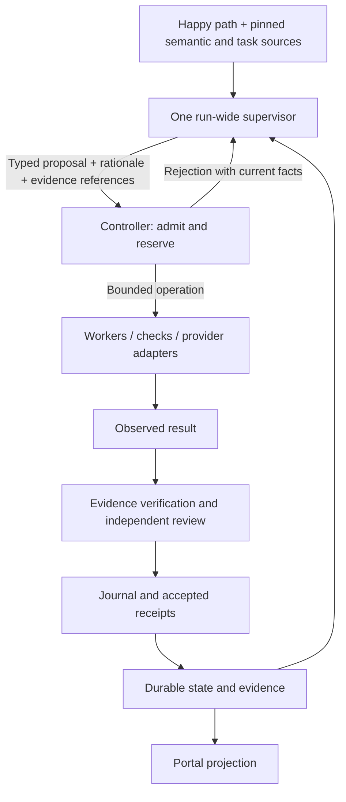

# Graph execution: happy-path authoring and supervisor-directed execution

Terminology adapted for GraphLoom; implementation references below describe Vajra.

Status: proposed, 2026-09-22. Architecture research and design, not implemented
or deployed. This proposal simplifies the authoring and execution model in
[run-wide supervisor repair](design-supervisor-run-repair.md). It retains that
design's protected outcomes, independently observed evidence, and bounded repair.

Research baseline: Loopx `main` at
[`67ffe60df4135a2fbbad8b64fc9753ba501dd2a2`](https://github.com/loopx-project/loopx/tree/67ffe60df4135a2fbbad8b64fc9753ba501dd2a2),
inspected on 2026-09-22. Findings below come from source and test inspection.
Loopx was not installed and its tests were not executed. RFCs and experimental
capabilities are distinguished from implemented behavior.

## 1. Decision

Graph authors declare the required happy path. One durable supervisor owns
the execution plan for the entire run: workers, prompts, validation, supporting
operations, diagnosis, repairs, and reentry. A small Go controller admits and
executes those decisions, records evidence, and enforces run authority and limits.

For `graphs/tdd-bydb.yaml`, the complete proposed graph file is:

```yaml
happy_path: [assign, implement, review, land]
```

The filename supplies the graph identity. Stage meanings come from versioned
context bound to that graph and target repository. Credentials, adapter
availability, scheduling, quotas, and delivery permissions remain project/runtime
configuration. They are not repeated in every graph file.

This is a genuinely smaller authoring surface, but it still requires shared
definitions of what the stage names mean. Arbitrary names cannot supply acceptance
criteria by themselves. An unresolved stage definition blocks intake with the
missing context identified; the supervisor must not guess its meaning.

For this TDD graph, the required outcome remains
`assign → implement → review → land`. Land means verifying delivery and making
the PR ready for maintainers. It does not authorize automatic merging.

## 2. What Loopx actually implements

### 2.1 Architecture: decisions, effects, and accepted progress

Loopx separates agents, providers, capabilities, and its control plane. Agents
reason and perform bounded work; providers connect to tools and external systems;
capabilities supply domain contracts; the kernel manages durable lifecycle,
coordination, and admission. Its implementation mixes Python orchestration with
canonical TypeScript decision and effect machinery. It is not one universal LLM
supervisor state machine.

The useful execution model is:

```text
facts → decision proposal → admission → effect execution
      → observation → validation → durable settlement → next decision
```

The coordination core explicitly treats decisions as proposals, not evidence that
a write committed. Material host results require an independent validator at the
turn-executor boundary. A missing validator, malformed result, or exception
prevents that result from being admitted as validated progress.

Sources: [architecture](https://github.com/loopx-project/loopx/blob/67ffe60df4135a2fbbad8b64fc9753ba501dd2a2/docs/architecture.md),
[coordination decisions](https://github.com/loopx-project/loopx/blob/67ffe60df4135a2fbbad8b64fc9753ba501dd2a2/loopx/control_plane/coordination/authority_core.py#L1),
[task validator](https://github.com/loopx-project/loopx/blob/67ffe60df4135a2fbbad8b64fc9753ba501dd2a2/loopx/control_plane/turn_driver/executor.py#L441).

**Transfer to Vajra:** supervisor output is a proposed operation. Worker output
is an observation. Neither can directly advance a milestone or finish a run.
The controller issues accepted receipts after checking the relevant evidence.

### 2.2 Durable turns are more useful than another routing DSL

Loopx settlements order validation, durable writeback, quota spending, and
conditional terminal closeout. Prepared provider effects are reconciled as
committed, absent, or unknown. A known commit is checkpointed; proven absence can
permit execution; an unknown result stops automatic replay. Its journal also
checks operation identity and legal phase ordering before resuming.

This solves a different problem from choosing a recovery route. After a process
crash, the first question is whether an earlier operation already happened.
Only after reconciliation should a model decide what to do next.

Sources: [settlement](https://github.com/loopx-project/loopx/blob/67ffe60df4135a2fbbad8b64fc9753ba501dd2a2/loopx/control_plane/turn_driver/settlement.ts#L34),
[journal recovery](https://github.com/loopx-project/loopx/blob/67ffe60df4135a2fbbad8b64fc9753ba501dd2a2/loopx/control_plane/turn_driver/turn_journal.ts#L356).

**Transfer:** journal supervisor actions before execution, retain their original
operation IDs, and reconcile external writes before retrying. Do not copy the
quota ordering as model-cost accounting: Vajra must reserve capacity before a
call and account for failed calls and rejected proposals too.

### 2.3 Ownership is current authority, not an old receipt

Loopx separates claim ownership, lease generations, provider revisions, and
historical operation receipts. Lease proof checks current execution identity and
expiry. An old successful ownership-transfer receipt cannot authorize a new
mutation. Storage contracts require conditional revisions and atomic commitment
of events, projections, and receipts, including explicit ambiguous outcomes.

Sources: [lease proof](https://github.com/loopx-project/loopx/blob/67ffe60df4135a2fbbad8b64fc9753ba501dd2a2/loopx/control_plane/coordination/task_lease_proof.ts#L29),
[command receipts](https://github.com/loopx-project/loopx/blob/67ffe60df4135a2fbbad8b64fc9753ba501dd2a2/loopx/control_plane/coordination/command_receipt.ts#L1),
[storage guarantees](https://github.com/loopx-project/loopx/blob/67ffe60df4135a2fbbad8b64fc9753ba501dd2a2/loopx/control_plane/coordination/authority_store.ts#L10).

**Transfer:** start with one run owner, a run generation, cross-process locking,
and expected-state revisions. These can fence stale supervisors and workers
without importing Loopx's complete distributed lease system or storage stack.

### 2.4 Decision Context resembles the proposed semantic binding

Loopx's experimental Decision Context capability collects versioned authority
sources, exact reads, and optional recall. Its caller supplies domain reasoning
through a callback. Evidence, proposed action, review settlement, and eventual
outcome are separate records. Changed-source cursors advance only after the
changes have been accounted for and the corresponding settlement recorded.

This is useful context infrastructure, not a prebuilt graph interpreter.
Optional memory can be unavailable without becoming authority. Required task
sources need stricter handling in Vajra: their absence must block decisions that
depend on them.

Sources: [runtime boundary](https://github.com/loopx-project/loopx/blob/67ffe60df4135a2fbbad8b64fc9753ba501dd2a2/loopx/capabilities/decision_context/runtime.py#L230),
[source accounting](https://github.com/loopx-project/loopx/blob/67ffe60df4135a2fbbad8b64fc9753ba501dd2a2/loopx/capabilities/decision_context/assembler.py#L454),
[settlement before cursor advancement](https://github.com/loopx-project/loopx/blob/67ffe60df4135a2fbbad8b64fc9753ba501dd2a2/loopx/capabilities/decision_context/review_settlement.py#L123).

**Transfer:** every supervisor decision references pinned context, unresolved
conflicts, evidence, and the current state revision. Conversation and remembered
lessons help reasoning but cannot silently replace those sources.

### 2.5 Its issue-fix graph still contains deterministic domain routing

Loopx's issue-fix capability maps agent observations about reproduction, scope,
and validation into `fix_pr`, `comment_only`, or `triage_only`. Repository context
changes the projected confidence but explicitly does not override the selected
route. Candidate preflight also contains domain-specific successors for existing
PRs, implementation evidence, and maintainer dispositions.

Sources: [feasibility routing](https://github.com/loopx-project/loopx/blob/67ffe60df4135a2fbbad8b64fc9753ba501dd2a2/loopx/capabilities/issue_fix/feasibility.py#L42),
[context does not override route](https://github.com/loopx-project/loopx/blob/67ffe60df4135a2fbbad8b64fc9753ba501dd2a2/loopx/capabilities/issue_fix/feasibility.py#L237),
[candidate preflight](https://github.com/loopx-project/loopx/blob/67ffe60df4135a2fbbad8b64fc9753ba501dd2a2/loopx/capabilities/issue_fix/candidate_preflight.py#L381).

**Do not transfer this structure into Vajra v2.** Replacing route YAML with a
growing Go switch statement would preserve the current failure mode. The
supervisor must interpret a previously unseen failure and choose a supporting
operation or reentry without adding a new domain classification to the engine.

### 2.6 Evidence checks have different strengths

Loopx includes actual command execution for declared Todo completion validation.
It also includes result checkers that validate model-declared statuses and scope
bindings. Those are different guarantees. Its PR review result checker explicitly
reports that semantic truth and remote-head verification were not performed.
One context matcher accepts high line-membership overlap, which does not establish
that a summarized claim is true or preserve the ordering of source text.

Sources: [executed completion validation](https://github.com/loopx-project/loopx/blob/67ffe60df4135a2fbbad8b64fc9753ba501dd2a2/loopx/control_plane/todos/completion_validation.py#L253),
[review checker limits](https://github.com/loopx-project/loopx/blob/67ffe60df4135a2fbbad8b64fc9753ba501dd2a2/loopx/capabilities/pr_review_queue/result_check.py#L247),
[context matching](https://github.com/loopx-project/loopx/blob/67ffe60df4135a2fbbad8b64fc9753ba501dd2a2/loopx/capabilities/context_providers/base.py#L33).

**Transfer:** record whether evidence is a claim, an independent review, or an
executed observation. A valid JSON shape, source hash, or passing process is not
by itself proof that the issue's actual requirement has been satisfied.

### 2.7 Scope limits worth preserving in the comparison

- Loopx does not demonstrate happy-path-only authoring or one persistent
  supervisor directing all off-path work. Those are Vajra design decisions.
- Its driver intentionally lets unregistered legacy actions reach host execution.
  A new Vajra v2 operation protocol should reject unsupported operations.
- Its explicit Todo continuation helper currently supports local, lease-free
  continuation; it rejects lease-bearing work. It is not a complete solution for
  moving a live supervisor between hosts.
- File storage is the default. Other provider profiles retain qualification work;
  their presence does not establish equal production readiness.

Sources: [legacy action fallback](https://github.com/loopx-project/loopx/blob/67ffe60df4135a2fbbad8b64fc9753ba501dd2a2/loopx/control_plane/turn_driver/driver.py#L96),
[continuation restriction](https://github.com/loopx-project/loopx/blob/67ffe60df4135a2fbbad8b64fc9753ba501dd2a2/loopx/control_plane/coordination/todo_continuation.ts#L159),
[provider qualifications](https://github.com/loopx-project/loopx/blob/67ffe60df4135a2fbbad8b64fc9753ba501dd2a2/loopx/control_plane/coordination/authority_store.ts#L42).

## 3. Authoring and semantic context

### 3.1 Bind a semantic bundle by convention

Use the existing control repo by default; a new repository or vector database is
not required. Proposed conventions:

```text
graphs/tdd-bydb.yaml                  # only happy_path
semantics/graphs/tdd-bydb.md           # objective and graph-specific meaning
semantics/stages/assign.md               # reusable stage responsibilities
semantics/stages/implement.md
semantics/stages/review.md
semantics/stages/land.md
semantics/repositories/<owner>/<repo>.md # repository rules and delivery policy
```

The resolver combines these definitions with the task's authoritative issue and
explicitly required parent sources, code revision, and existing project settings.
A separate semantic repo can be bound once in project configuration if teams need
to share it. The run pins its commit independently of the code and control commits.
External semantic content is reference material; it cannot grant credentials or
expand the operator's permissions.

Stage definitions describe purpose, required outcomes, evidence expectations,
boundaries, and examples. They can identify existing test commands and tools.
They should not enumerate every failure and successor, or hide the old routing
matrix in Markdown. The supervisor chooses the actual execution sequence.

The resolved bundle records exact files/ranges, digests, source revisions,
authority class, and unresolved conflicts. Task requirements and operator policy
are authoritative; repository observations establish current facts; recalled
lessons are advisory. Conflicts between authoritative requirements are surfaced
and resolved explicitly, not by selecting whichever text makes a test pass.

### 3.2 Derive the run contract before executing the task

Intake pins the happy path and source manifest. The supervisor then derives a
run-specific obligation and evidence plan. A bounded independent review checks
that interpretation against the pinned sources before implementation starts.
Ordinary authorized runs need no additional human approval. A real requirement
conflict or missing authority parks the run with a concrete unresolved question.

There are three distinct objects:

| Object | Contents | Change authority |
|---|---|---|
| Source contract | Happy-path order, original obligations, source revisions, delivery permission | Explicit authorized requirements revision |
| Derived acceptance plan | Source-to-obligation mapping and required evidence | Supervisor proposal, independently checked for preservation |
| Execution recipe | Workers, models, prompts, commands, hooks, supporting jobs | Supervisor, within runtime permissions and qualification rules |

The detailed runtime contract is generated and inspectable; authors do not repeat
it in graph YAML. The source contract remains outside worker write access.
Correcting a mistaken interpretation does not require pretending the underlying
issue changed. Dropping or changing a real requirement does require an authorized
source revision and invalidation of dependent evidence.

For TDD, assign must compare the issue, parent context, proposed assignment, and
tests for contradictions. Implement can submit a conflict report referencing those
sources. It is not forced to satisfy an assignment that contradicts the issue.

### 3.3 Keep generic graphs generic

The same mechanism supports, for example:

```yaml
happy_path: [collect, analyze, publish]
```

Those stages have their own semantics and evidence. They need no TDD assignment
artifact. Scheduled versus kanban dispatch stays in the portal/project binding;
it does not change the supervisor protocol. V2 initially defines an ordered list
of required milestones. Parallel worker jobs are allowed inside a milestone;
parallel business milestone graphs are outside this first version's scope.

## 4. Runtime architecture



### 4.1 Responsibility boundary

| Concern | Supervisor owns | Controller owns |
|---|---|---|
| Happy-path execution | How to achieve each required stage | Required order and accepted completion |
| Validation | Which checks prove an obligation; how to repair a defective check | Check execution, qualification requirements, evidence provenance and freshness |
| Hooks | When supporting work is needed and its bounded recipe | Execution permissions, timeout, output capture |
| Reentry | Whether to revisit assign, implement, review, or the current stage | Stage identity, affected receipt invalidation, current ownership |
| Failures | Interpretation of all observed failures and proposed remedy | Typed raw observations and safe admission of the proposed operation |
| Models and prompts | Selection and revision within available capabilities | Installed adapters, allowed models, resource and credential bounds |
| Completion | Explanation of why the outcome is satisfied | Required receipts and delivery-policy enforcement |
| Waiting and stopping | Meaning of a blocker and proposed next action | Cancellation, deadlines, counters, resumable lifecycle |

Thus validation belongs to the supervisor as a planning responsibility. Its
execution and acceptance remain independently enforced. The supervisor cannot
turn a failing requirement into success by removing its check.

### 4.2 A small operation vocabulary

Use generic operations such as `inspect`, `dispatch_stage`, `execute_check`,
`revise_recipe`, `return_to_stage`, `wait`, and `propose_completion`. Supporting
jobs use a bounded dispatch operation with declared effect scopes. Do not create
an operation kind for every defect, model, hook, or domain-specific recovery.

Each proposal contains an operation ID, run generation, expected state revision,
stage or obligation references, inputs, execution/context revision, bounded
effects, expected observation, and a concise rationale. Unsupported operations
are rejected with structured feedback. Raw error text remains available alongside
generic failure fields so the model can investigate unfamiliar failures.

Successful forward movement follows the list after evidence is accepted; it does
not require model debate over the next stage. Any choice outside that normal
advance returns to the supervisor. There is no separate classifier session,
repair session, or graph-specific failure table.

### 4.3 One logical supervisor session

The session spans initial planning, normal execution, review feedback, every
recovery episode, and finalization. Worker and independent reviewer sessions are
children whose results return to it. Provider context compaction or model
replacement creates a continuation of that logical session, preserving identity,
decisions, evidence, and budgets.

Persist these facts outside provider conversation history. If native resume is
unavailable, reconstruct from the pinned contract, journal, artifact references,
and compacted decision summaries. Reconcile unfinished effects before asking the
replacement session for a new action. A crashed or unavailable supervisor cannot
repair itself while unable to run: the controller may use a configured bounded
adapter fallback, then park if no supervisor is available.

## 5. Verification without self-authorized success

1. The supervisor maps each obligation to checks and, where necessary, semantic
   review. Every required obligation must have an evidence strategy.
2. Existing trusted repository checks can be selected directly. New or changed
   validators undergo independent qualification before their results count.
3. Qualification binds the check to the unchanged source obligation, includes
   meaningful negative examples or regression sensitivity where applicable, and
   reviews whether the proposed fix weakens what is being verified.
4. The controller executes the admitted check in the declared workspace and
   records command/tool identity, inputs, code digest, context revision, verifier
   revision, result, and output digest. Worker-written success flags do not count.
5. Independent review supplies explicit judgment where commands cannot prove a
   semantic requirement. The system records that evidence as review, not as
   machine proof. No finite test set or second model guarantees interpretation of
   arbitrary prose; unresolved disagreement consumes bounded recovery or parks.
6. A code, source, assignment, or verifier change invalidates dependent receipts.
   Implement after review requires fresh review of the resulting deliverable.

Qualification itself is a controller-required procedure, not a gate the supervisor
may delete. It is bounded and cannot recursively launch unlimited reviewers.
Controller-owned receipts and state must be inaccessible to worker writes;
hashing a worker-writable YAML file is not an authority boundary.

For example, a malformed `validate_revision` hook can be replaced in the run-local
recipe after reproducing its parser failure, checking its intended obligation,
qualifying the correction, and rerunning it. The obligation stays required. This
needs no publication to the control repo's default branch.

## 6. Recovery, reentry, and limits

### 6.1 Reproduce the real conflict as a first-class scenario

```text
assign accepted
  → implement observes that assignment requires behavior the issue removes
  → supervisor compares the exact sources and confirms interpretation error
  → return to assign with a conflict report
  → revise assignment and affected tests; independently verify preservation
  → implement → review → land
```

The required happy path has not changed. Earlier accepted receipts remain in
history but are invalidated where the correction affects them. Review findings
can similarly return to implement or assign according to their meaning. No author
needs `on_failure`, `when`, or a reentry entry for each possibility.

The supervisor can change models, prompts, hook implementations, validation
recipes, environment setup, or supporting operations within its authority. It
cannot rewrite its own controller, grant itself permission, erase budgets, or
remove required stages. Engine defects that prevent the controller running and
unavailable external authority require an external fix; “all failures are eligible
for diagnosis” is not a guarantee that every failure is autonomously repairable.

### 6.2 Explicit bounded policy

Preserve the proposed M1 recovery defaults in project policy, not graph YAML:

| Limit | Default |
|---|---:|
| Recovery attempts per run | 8 |
| Attempts per episode | 3 |
| Consecutive attempts without verified progress per episode | 2 |
| Model calls per attempt, shared by supervisor and children | 8 |
| Active recovery time | 4 hours |
| Elapsed recovery time | 24 hours |
| Infrastructure retries per operation ID | 2 |

An attempt includes diagnosis, one proposed correction, its qualification, and
the affected-stage trial. Its internal calls consume the call/time allowance;
they are not separate attempts. Rejected proposals and unsuccessful trials spend
their reserved allowance. Failure wording, helper names, model replacement, Retry,
and graph refresh cannot reset the counters.

V2 changes the older distinction between ordinary correction routes and repair:
all supervisor-directed retries and backward corrections after an unmet obligation
use this budget, including a review rejection. There is no unmetered hidden
“ordinary correction” route. Normal first-pass checks and forward execution are
covered by a separate finite run execution envelope. Initial proposed defaults
are 64 total model calls across all actors and 24 hours elapsed after first
dispatch; recovery calls also count toward this total. Projects may adjust these
limits explicitly. They are rollout defaults to calibrate, not measured Loopx
recommendations.

Infrastructure retries retain the original operation identity and consume their
own bounded counter and applicable call/time usage; they cannot become unlimited
by being described as planning. Episode closure requires controller-accepted
evidence of the previously missing progress. A new unrelated failure may open
another episode but still shares the run-wide cap.

Exhaustion produces a resumable stopped run with the blocker, attempted remedies,
and remaining budgets. It does not archive the run. A user may explicitly extend
the allowance with an audit record; retrying alone never replenishes it.

## 7. Crash safety and external effects

Use the existing subprocess and cross-process lock model. Persist one canonical
run journal containing admitted operation intent, reservations, state revision,
receipts, and pending publication records. Stage and portal state are projections.
M1 budget/session records must participate through idempotent reservation and
settlement IDs, with reconciliation if a crash separates their writes; do not
assume several individually atomic files form one transaction.

Before a side effect, persist its intent and operation identity. After execution,
persist its observation and acceptance separately. On recovery:

- A committed operation returns its retained result.
- A prepared operation is reconciled against provider state.
- A proven absent operation may be retried under the same identity and bounds.
- An ambiguous effect remains blocked until readback establishes what happened.

A remote Git push or PR-ready request therefore cannot be blindly replayed because
the local process missed the response. Providers need effect-specific readback;
an operation ID alone does not make arbitrary shell commands idempotent.

For the first version, the durable host journal is authoritative during execution;
Git is its versioned replication/export, with explicit pending publication status.
Do not reconstruct missing reservations from an older Git checkpoint and grant
new allowance. Host restore requires the canonical journal and session backup;
automatic cross-host failover is outside the initial release. No new database is
required, but multi-file crash tests are required.

Cancellation increments the run generation, stops dispatch, and reaps affected
workers before accepting new work. Late results from the old generation cannot
mutate state or trigger delivery. Cancelling cannot undo an external write that
already happened; recovery must still reconcile it.

## 8. Portal behavior

The business view displays the declared happy path. The current stage contains
the active supporting operation and supervisor's concise decision summary:

```text
Implement · recovering · attempt 2/8
Assignment conflicts with issue §3; returning to Assign to correct the tests.
Current operation: verify corrected assignment
Next required stages: Implement → Review → Land
```

The activity view shows stable operation IDs, observed phase, evidence links,
decision summaries, revisions, attempts, and waiting reasons. Build, setup,
validation, and reentry appear as supporting work, not additional business lanes.
Use concise reasons and evidence references rather than private model reasoning.
All projections come from durable records, so refresh and reconnect cannot invent
progress or discard an in-flight operation.

## 9. Implementation plan and compatibility

The earlier M1 work provides contract/receipt, invalidation, persistent session,
and recovery-budget foundations in its separate implementation checkout. It does
not yet provide supervisor-directed repair dispatch or v2 authoring. Reuse those
foundations after integration; do not label this proposal already implemented.

Do not compile v2 into a hidden static v1 failure graph. Build a supervisor
director above reusable bounded worker/check execution, with v1 and v2 explicitly
coexisting. Preserve adapter contracts, artifact separation, and existing import
boundaries. In particular, the router must not import the supervisor and the PR
loop must not acquire orchestration responsibilities.

| Milestone | Deliverable | Exit evidence |
|---|---|---|
| V2.1: authoring and pinned context | Strict list-only graph schema; semantic resolver; generated acceptance preview; protected source manifest | TDD and scheduled examples; unresolved definitions and contradictory sources rejected; no duplicated route YAML |
| V2.2: durable supervisor director | One run-wide session; typed proposal/admission; bounded worker/check execution; journal, fencing, reservation and readback | Entire happy path with stub agents; restart at effect boundaries; duplicate Retry and stale worker results cannot duplicate effects |
| V2.3: adaptive verification and recovery | Run-local recipe repair; independent qualification; dynamic reentry; all budgets enforced | Original assignment conflict and broken validation hook recover; unknown failure needs no new classifier; weakened check and forged success rejected |
| V2.4: portal and controlled rollout | Stage/operation projection; recovery controls; explicit migration; real-provider evaluation | Screenshots plus end-to-end TDD delivery to a private test PR, cancellation/restart cases, and a scheduled graph with no assignment artifact |

Use proposal-only or isolated execution until V2.2 durability is qualified.
Autonomous broad repair is enabled only after V2.3's negative cases pass.

The new loader rejects mixed v1/v2 fields and unknown v2 keys. Project catalog
metadata advertises the minimum engine capability outside the graph file.
Deployment checks must prove the actual binary understands v2 before publication
enables those graphs; old binaries may silently ignore unfamiliar YAML.

V1 validation/coverage gates remain intact. V2 gates validate semantic resolution,
operation contracts, and scenario behavior; dynamic routing cannot honestly be
measured as 100% coverage of a static route graph. Update the control-repo gate
explicitly for this format. Source-only parsing success is insufficient.

Start with new runs. Migrating a stopped legacy run requires reconciliation of
pending effects, pinned sources and obligations, explicit stage mapping, and
preserved budgets. Do not move active legacy runs to a new cursor automatically.

## 10. Required verification scenarios

Tests should exercise real controller boundaries and meaningful negative cases,
not merely assert that a scripted model selected a route.

| Scenario | Required result |
|---|---|
| Happy path with no failures | All stages verified in order; no recovery allowance spent |
| Issue removes a behavior but assignment requires it | Conflict found during assign, or returned there from implement; original requirement preserved |
| Broken `validate_revision` parser | Original parser error retained; run-local repair qualified; actual obligation rerun |
| Unsupported worker model or provider outage | Bounded model/adapter change; no session or budget reset |
| Unrecognized failure text | Supervisor can investigate and propose operations without a new domain enum |
| Proposed validator always passes | Qualification rejects it; no milestone receipt |
| Forged worker evidence or mutated controller artifacts | Admission rejects or detects the write; worker cannot mint authority |
| Source or code changes after review | Dependent receipts invalidated; fresh review required |
| Repeated invalid proposals or no-progress fixes | Call/attempt/time limits stop the run; Retry preserves usage |
| First-stage planning loops indefinitely | Global execution envelope stops it, even before recovery begins |
| Process death between reservation, execution, and settlement | Reconciliation preserves spend and prevents duplicate dispatch |
| Remote effect succeeds but response is lost | Readback accepts existing effect; no duplicate publication |
| Cancellation overlaps worker completion | Old generation cannot advance or publish |
| Memory conflicts with current source | Source governs; recalled lesson is marked stale/advisory |
| Required source unavailable | Dependent decisions park; optional memory failure does not block unrelated work |
| No eligible issue or justified no-op | Recorded as a distinct authorized outcome; never fabricated completion of missing stages |
| Generic scheduled graph | Own stage meanings and evidence; no TDD-specific contract dependency |

Relevant Loopx test sources inspected for design precedents include
[receipt conformance](https://github.com/loopx-project/loopx/blob/67ffe60df4135a2fbbad8b64fc9753ba501dd2a2/tests/control_plane_ts/coordination_receipt_conformance.ts),
[journal faults](https://github.com/loopx-project/loopx/blob/67ffe60df4135a2fbbad8b64fc9753ba501dd2a2/tests/control_plane_ts/turn_journal.test.ts),
[completion validation](https://github.com/loopx-project/loopx/blob/67ffe60df4135a2fbbad8b64fc9753ba501dd2a2/tests/control_plane/test_todo_completion_validation.py),
and [decision context settlement](https://github.com/loopx-project/loopx/blob/67ffe60df4135a2fbbad8b64fc9753ba501dd2a2/tests/capabilities/test_decision_context_runtime.py).

The architectural choice is to adopt Loopx's separation of proposal, authority,
evidence, and effects while making graph semantics and off-path decisions the
responsibility of Vajra's persistent supervisor.
